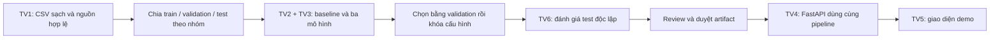

# HCM Apartment Price AI

**Ước tính tổng giá rao bán căn hộ tại TP.HCM bằng Machine Learning.** Đồ án nhóm 6 người trong 4 tuần: so sánh Linear Regression, Polynomial Regression và Decision Tree, giải thích kết quả rồi cung cấp API để demo.

Người dùng nhập diện tích, khu vực và một số thuộc tính căn hộ. Hệ thống dự kiến trả tổng giá VND, đơn giá/m², ngày dữ liệu và cảnh báo. Giá ước tính phản ánh **giá rao bán**, không phải giá giao dịch đã chốt hay dự báo giá tương lai. Dự án dùng **TP.HCM theo địa giới hiện hành và giá quan sát gần thời điểm chạy**, không giới hạn theo mốc trước năm 2025.

[Hướng dẫn chạy](#chay) · [Luồng xử lý](#luong) · [API](#api) · [Phân công](docs/TEAM.md) · [Checklist tiến độ](docs/TEAM.md#checklist) · [Yêu cầu nghiệm thu](docs/SPEC.md)

## Hiện dự án làm được gì?

| Đã có trong code | Còn phải hoàn thiện |
| --- | --- |
| Schema dữ liệu/đầu vào chung, tải CSV chuẩn hóa, chọn đại diện và chia nhóm | Nguồn dữ liệu thị trường được phép dùng, audit và nhóm trùng từ dữ liệu thô |
| Baseline + ba mô hình, chọn bằng validation, đánh giá holdout riêng | Importance/ablation, báo cáo thực nghiệm từ dữ liệu thật |
| FastAPI: metadata, dự đoán, report, health; chặn model thiếu/quá hạn | Quy trình phê duyệt/phát hành đầy đủ, UI và giới hạn khi public |
| pytest, Ruff và workflow GitHub Actions | Demo có model thật đã duyệt và dữ liệu còn hạn |

**Chưa có dataset thị trường hay model được duyệt kèm repo.** Test dùng dữ liệu giả để kiểm tra kỹ thuật. Chạy API ngay được; `/health/ready` và dự đoán trả **503** khi thiếu model là hành vi đúng. Kết quả test không phải độ chính xác thị trường.

## Công nghệ đang dùng

| Phần | Công nghệ | Dùng để làm gì? |
| --- | --- | --- |
| Môi trường | Python 3.12, pip, venv | Một môi trường chung cho ML và API |
| Dữ liệu | pandas, NumPy | Đọc bảng, kiểm tra và chuẩn hóa |
| Học máy | scikit-learn, joblib | Pipeline tiền xử lý, ba mô hình, lưu artifact nội bộ |
| HTTP | FastAPI, Pydantic, Uvicorn | Kiểm tra JSON, phục vụ dự đoán, Swagger UI |
| Kiểm tra | pytest, Ruff, GitHub Actions | Test hành vi, lint và CI |

React/TypeScript là hướng UI dự kiến cho TV5; hiện chưa có frontend. Không cần Node.js để cài hoặc chạy repo Python này. Chưa cần database, tài khoản hay queue cho MVP.

<a id="luong"></a>
<a id="kien-truc"></a>
## Luồng xử lý



**Huấn luyện chạy offline.** API chỉ nạp mô hình đã duyệt, kiểm tra độ mới rồi dự đoán; không huấn luyện lại mỗi request. Cùng một pipeline xử lý đặc trưng ở offline và HTTP để kết quả khớp nhau. Bước duyệt artifact và UI vẫn đang trong kế hoạch.

## Cấu trúc repo

```text
.github/        CI, lock thư viện Python, mẫu PR và CODEOWNERS
backend/        app.py: HTTP; service.py: nạp model và kiểm tra đầu ra
ml/             schema, dữ liệu, mô hình, train và evaluate
tests/          toàn bộ test chính thức và fixture kỹ thuật
docs/           SPEC.md: yêu cầu; TEAM.md: phân công và mốc
.gitignore      chặn môi trường, cache, dữ liệu riêng và artifact
AGENTS.md       quy tắc làm việc và review
README.md       hướng dẫn, hợp đồng, thuật ngữ và quyết định kỹ thuật
pyproject.toml  package Python và cấu hình pytest/Ruff
```

`.venv/`, dữ liệu nguồn, cache và artifact là file cục bộ được bỏ qua bởi Git. Giữ nguyên file đề gốc `docs/detai.docx` tại máy; không đưa lên repo. Không tạo thư mục dự phòng rỗng ở root.

<a id="chay"></a>
## Cài đặt và chạy

Cần **Python 3.12** và Git. PowerShell, từ thư mục dự án:

```powershell
git clone https://github.com/KhiemPham1512/hcm-apartment-price-ai.git
cd hcm-apartment-price-ai
py -3.12 -m venv .venv
.venv/Scripts/python.exe -m pip install -r .github/requirements-dev.lock
.venv/Scripts/python.exe -m pip install --no-deps --no-build-isolation -e .
```

Không cần activate venv khi gọi trực tiếp Python như trên. Linux/macOS: dùng `python3.12 -m venv .venv`, rồi thay `.venv/Scripts/python.exe` bằng `.venv/bin/python`.

**Chạy kiểm tra:**

```powershell
.venv/Scripts/python.exe -m pytest -q
.venv/Scripts/python.exe -m ruff check .
.venv/Scripts/python.exe -m pip check
```

**Mở API:**

```powershell
.venv/Scripts/python.exe -m uvicorn backend.app:app --host 127.0.0.1 --port 8000 --no-proxy-headers
```

Mở [Swagger UI](http://127.0.0.1:8000/docs) để thử các endpoint. Thử nhanh trong terminal khác:

```powershell
Invoke-RestMethod http://127.0.0.1:8000/health/live
Invoke-RestMethod http://127.0.0.1:8000/api/v1/metadata
```

Kỳ vọng khi chưa có model: live trả `status=live`, metadata trả `serving_status=unavailable` và danh sách khu vực rỗng. Readiness/dự đoán trả 503; kiểm tra manifest, đường dẫn và ngày dữ liệu khi đã có model mà vẫn nhận 503.

**Huấn luyện và đánh giá khi TV1 đã bàn giao CSV/card hợp lệ:**

```powershell
.venv/Scripts/python.exe -m ml.train --help
.venv/Scripts/python.exe -m ml.evaluate --help
.venv/Scripts/python.exe -m ml.train --csv data/processed/current.csv --dataset-card data/processed/card.json --output artifacts/run-001
.venv/Scripts/python.exe -m ml.evaluate --run-dir artifacts/run-001
```

Các đường dẫn trên là ví dụ đầu vào nội bộ, chưa có file dữ liệu kèm repo. Card phải khớp `DatasetCard` trong `ml/schema.py`, bắt buộc ghi `geography_version="hcm_current_v1"`; card thiếu phiên bản hoặc dùng phạm vi cũ bị từ chối, không tự đổi nhãn để tiếp tục chạy. Dùng thư mục run mới; `evaluate` không ghi đè báo cáo đã có. CLI kiểm tra checksum, đủ baseline + ba mô hình, winner hợp lệ, split không lặp tin/nhóm và holdout khớp đúng danh sách test đã khóa; thất bại thì không tạo báo cáo. Train tạo candidate, evaluate tạo `evaluation.json`; hai lệnh **chưa tự phê duyệt model**.

Khi đã được bàn giao gói phát hành đáng tin cậy gồm `manifest.json`, `pipeline.joblib` và báo cáo nếu có, đặt `MODEL_DIR` trỏ tới thư mục đó trước khi chạy Uvicorn:

```powershell
$env:MODEL_DIR = (Resolve-Path artifacts/approved-run).Path
.venv/Scripts/python.exe -m uvicorn backend.app:app --host 127.0.0.1 --port 8000 --no-proxy-headers
```

Chỉ dùng lệnh này sau khi thư mục approved đã tồn tại và qua review. Không đổi tên candidate hay sửa ngày/`release_status` để vượt kiểm tra. Manifest theo `backend/service.py`; joblib chỉ được nạp từ nguồn nội bộ đáng tin.

## Bắt đầu đọc và nhận việc

Đọc `ml/schema.py` → `ml/data.py` → `ml/models.py` → `ml/train.py` → `ml/evaluate.py` → `backend/service.py` → `backend/app.py`. Test ở `tests/` cho thấy hành vi mong đợi.

**Vai trò đề xuất để nắm toàn dự án: TV6 — giữ luồng tích hợp và kiểm định xuyên suốt.** Người phụ trách chạy lại sản phẩm của từng thành viên, kiểm tra điểm bàn giao và điều phối tiếp quản khi có người trễ. Lộ trình ngày 1–28, bằng chứng cần nhận và cách giữ holdout độc lập nằm trong [TEAM](docs/TEAM.md).

Yêu cầu chỉ ở [SPEC](docs/SPEC.md), phân công và [hướng dẫn GitHub từng bước](docs/TEAM.md#github-workflow) ở TEAM, quy tắc Git ở [AGENTS](AGENTS.md). [GitHub Issues](https://github.com/KhiemPham1512/hcm-apartment-price-ai/issues) giữ trao đổi/tiến độ, PR giữ thay đổi và review. **Không push trực tiếp lên `main`: tạo nhánh riêng từ `origin/main`, push nhánh đó rồi mở PR.** Merge cần CI xanh và reviewer khác tác giả; không force-push. Branch protection chưa được xác minh.

Với ticket tính năng đã có tên và tiêu chí: viết test hành vi thất bại → sửa tối thiểu → chạy lại test → dọn file tạm/cache → PR. Test nghiệp vụ cần giữ được chuyển thành test chính thức trong `tests/`; không dùng test tạm bị xóa làm bằng chứng duy nhất.

### Khi thành viên dùng AI riêng

Tài liệu đủ để hiểu mục tiêu và quy tắc; **issue được giao mới xác định việc cần làm**. Clone repo không mang theo nội dung GitHub Issues/PR. Trước mỗi việc, AI cần đọc README → AGENTS → SPEC → dòng vai trò trong TEAM → issue và thảo luận → code/test liên quan. Không cần đọc mọi module để sửa một phần nhỏ.

Tiến độ thực tế lấy từ [Issues](https://github.com/KhiemPham1512/hcm-apartment-price-ai/issues), [PR](https://github.com/KhiemPham1512/hcm-apartment-price-ai/pulls) và [CI](https://github.com/KhiemPham1512/hcm-apartment-price-ai/actions): code đã merge vào `main` là bản tích hợp; PR mở vẫn đang đề xuất. TEAM giữ owner/mốc, không giữ một bảng trạng thái thứ hai. Nếu AI không truy cập được GitHub, thành viên cung cấp nội dung issue và PR liên quan; AI phải ghi rõ phần chưa kiểm tra.

Có thể giao AI bằng mẫu sau, thay vai trò và issue trước khi gửi:

```text
Tôi phụ trách TV<1–6>, triển khai issue #<số> của repo này.
Đọc README.md trước, rồi AGENTS.md, docs/SPEC.md, docs/TEAM.md.
Đọc issue/thảo luận và kiểm tra PR đang mở để biết owner, phạm vi và phụ thuộc.
Fetch origin, tạo nhánh từ origin/main; chỉ sửa file trong phạm vi issue.
Đọc code và test liên quan; kiểm tra hành vi hiện có trước khi sửa.
Làm từng vòng RED → GREEN, giữ test nghiệp vụ trong tests/.
Không tạo thư mục root mới, không sửa file chung của owner khác khi chưa phối hợp.
Cập nhật hợp đồng nếu thay interface; chạy kiểm tra, dọn file tạm/cache.
Commit, push, mở draft PR ghi phạm vi và bằng chứng; không tự merge.
Báo rõ phần đã chạy, phụ thuộc còn thiếu và bước tiếp theo trên issue/PR.
```

## Tra cứu kỹ thuật khi triển khai

Các phần dưới giữ hợp đồng chi tiết; người mới chỉ cần phần phía trên để hiểu và chạy dự án.

[Đầu vào và độ mới](#du-lieu) · [Quy trình AI](#ai) · [HTTP](#api) · [Bảo mật](#bao-mat) · [Thuật ngữ](#thuat-ngu) · [Quyết định](#qd1) · [Vận hành](#van-hanh) · [Nguồn tham khảo](#nghien-cuu-ai)

<a id="du-lieu"></a>
<details>
<summary><strong>Hợp đồng dữ liệu</strong></summary>

Owner: TV1. Reviewer: TV2 và TV6. Đây là nguồn chuẩn cho đơn vị, tên trường, phạm vi đầu vào và độ mới. Không phải mô tả một dataset đã có.

## Nhãn và phạm vi

- Nhãn duy nhất: `asking_price_vnd`, tổng giá rao **bán** toàn bộ căn hộ; tiền VND. Thuê, trả góp theo tháng, giá mỗi m² chưa quy đổi, giá “thỏa thuận”, giao dịch không rõ loại đều bị loại hoặc cách ly để xác minh.
- `property_type = apartment`, `listing_type = sale` là trường kiểm tra phạm vi, không phải đặc trưng cho mô hình trong MVP một loại.
- MVP ưu tiên một nguồn chính qua gate, không ghép thêm nguồn để tăng số mẫu trước khi kiểm tra quyền, đơn vị và trùng liên nguồn. `source_id` vẫn lưu để truy vết và hỗ trợ adapter mở rộng về sau.
- Phạm vi là TP.HCM theo địa giới hiện hành tại thời điểm snapshot. `geography_version="hcm_current_v1"` là phiên bản danh mục khu vực được chốt cho đợt dữ liệu này; TV1 bàn giao mapping có nguồn, ngày hiệu lực và checksum. Nếu địa giới hoặc đơn vị thay đổi, tạo phiên bản mapping/contract mới qua PR, không sửa ngầm danh mục đã khóa. Chưa có mapping thực tế kèm repo.
- Giữ các tên trường kỹ thuật `district_code`, `district_labels`, `supported_districts` để không đổi tên hàng loạt interface; chúng biểu diễn mã/nhãn **khu vực được hỗ trợ**, không bắt buộc là quận/huyện cũ. Danh mục chuẩn dùng đơn vị hiện hành; tên địa chỉ cũ chỉ là đầu vào cần ánh xạ có bằng chứng. API chỉ phục vụ khu vực có trong metadata và đủ dữ liệu, không tự tuyên bố bao phủ toàn thành phố.
- Phải phân biệt diện tích sử dụng/thông thủy và diện tích xây dựng. Chỉ dùng một cách đo được xác minh hoặc một nhóm nhất quán; `area_basis` phải được ghi trong dataset card và artifact. Nếu nguồn không rõ, ghi `source_reported_unknown`, audit và nêu giới hạn; không tuyên bố hai cách đo tương đương.

## Các trường chuẩn

| Trường | Kiểu / đơn vị | Bắt buộc trong dữ liệu sạch | Dùng làm X? | Quy tắc |
| --- | --- | --- | --- | --- |
| `listing_id` | string | Có | Không | ID nguồn; không chứa số điện thoại |
| `source_id` | string | Có | Không | Khóa nguồn đã được phép dùng |
| `property_group_id` | string | Có | Không | Nhóm nghi cùng căn; do pipeline gộp trùng tạo |
| `published_at` | ISO-8601 có timezone | Có | Không | Thời gian đăng đã xác minh; không dùng ngày tải file để điền |
| `price_observed_at` | ISO-8601 có timezone | Có | Không | Thời điểm nguồn/bản chụp xác nhận chính mức giá trong dòng; không suy từ ngày đăng nếu giá đã sửa |
| `source_snapshot_at` | ISO-8601 có timezone | Có | Không | Thời điểm lấy snapshot nguồn |
| `active_at_snapshot` | boolean, phải true | Có | Không | Nguồn/export có bằng chứng tin còn rao bán khi chụp snapshot |
| `availability_evidence_id` | string | Có | Không | Tham chiếu bằng chứng lọc tin đang bán trong kho nội bộ; không chứa PII |
| `district_code` | string từ danh mục | Có | Có | Khu vực nghiên cứu; khi serving phải thuộc danh sách hỗ trợ |
| `area_m2` | số hữu hạn, m² | Có | Có | Từ 10 đến 500, bao gồm hai đầu |
| `bedrooms` | integer hoặc null | Không | Có | 0–10; 0 có thể là studio, null là không biết |
| `bathrooms` | integer hoặc null | Không | Có | 0–10; không thay null bằng 0 |
| `floor_level` | integer hoặc null | Không | Có | 0–100; chỉ tầng căn hộ, không phải số tầng cả tòa |
| `asking_price_vnd` | số hữu hạn dương, VND | Có | **y** | Bắt buộc xác minh tổng giá; không làm X |
| `property_type` | literal `apartment` | Có | Không | Loại khác ngoài MVP |
| `listing_type` | literal `sale` | Có | Không | Không trộn tin thuê |
| `area_basis` | enum theo dataset card | Có | Không | Một quy ước diện tích nhất quán cho mỗi phiên bản |
| `project_name_normalized` | string hoặc null | Không | Không | Chỉ hỗ trợ gộp trùng và phân tích tập trung dự án |

Phạm vi số ở trên là giới hạn MVP do nhóm chọn, không phải phát biểu về toàn bộ thị trường. Căn hộ ngoài phạm vi không nên ép về giá trị biên. Phải đếm và báo tỷ lệ bị loại; không thay giới hạn sau khi xem lỗi test. Nếu một cột tùy chọn thiếu toàn bộ trong train, bỏ khỏi feature set bằng một phiên bản hợp đồng mới trước khi freeze, không âm thầm đổi pipeline.

`price_per_m2_vnd = asking_price_vnd / area_m2` chỉ phục vụ EDA/kiểm tra/hiển thị. Không được đưa vào X vì có nhãn giá. Không đưa ID, URL, điện thoại, tên người bán, nguyên văn mô tả hoặc địa chỉ căn cụ thể vào X.

## Độ mới — cấu hình chuẩn duy nhất

| Tên | Giá trị MVP | Ý nghĩa |
| --- | --- | --- |
| `recent_window_days` | 90 ngày | Giữ tin có `published_at` trong `[T-90 ngày, T]`, T là snapshot; đây là giới hạn tuổi tin, không phải bằng chứng có lịch sử giá |
| `publication_max_snapshot_age_days` | 7 ngày | Khi phát hành, snapshot nguồn không cũ hơn mức này |
| `publication_max_data_age_days` | 7 ngày | Khi phát hành, từng mức giá trong snapshot hiện hành phải được quan sát trong khoảng này |
| `serving_max_data_age_days` | 14 ngày | Quá hạn này API không trả giá với nhãn hiện tại |
| `refresh_interval_days` | 7 ngày | Nhóm chuẩn bị snapshot và ứng viên cập nhật, không tự động bỏ qua cổng đánh giá |
| `min_train_groups_per_district` | 20 nhóm | Khu vực ít hơn mức này không được phục vụ |

`data_as_of = min(price_observed_at)` của snapshot hiện hành dùng cho phát hành: đây là mốc bảo thủ để không dùng một tin mới che các mức giá cũ. Lưu thêm `data_latest_at = max(price_observed_at)`. Luôn `published_at <= price_observed_at <= source_snapshot_at <= now`; không tạo `price_observed_at` bằng thời điểm tải lại CSV cũ. Export hiện hành do nguồn xác nhận giá/active tại T có thể dùng T cho thời điểm quan sát giá, nhưng không được giả tạo lịch sử giá trước T.

Manifest/API bắt buộc có `age_summary = {median_listing_age_days, median_price_age_days, computed_at}` để UI công bố tuổi tin và tuổi quan sát giá. `data_window_start/end` là min/max của `price_observed_at` trong snapshot hiện hành; `listing_window_start/end` là min/max của ngày đăng. `evaluation_window_start/end` riêng cho dữ liệu đánh giá; ba khoảng này không được dùng thay nhau. Kiểm tra phân bố tuần và tập trung dự án: dữ liệu mới không tự bảo đảm đại diện thị trường.

Tính thời gian bằng UTC có timezone; hiển thị theo `Asia/Ho_Chi_Minh`. So sánh bằng khoảng thời gian thực, không chỉ so chuỗi ngày. Timestamp tương lai hoặc không rõ nguồn → cách ly. Giới hạn bằng đúng ngưỡng vẫn hợp lệ. Chỉ thay các cấu hình này qua PR hợp đồng; không sửa riêng frontend để tránh báo hết hạn.

## Pipeline chuẩn hóa và gộp trùng

1. Lưu bản raw bất biến có checksum, license/permission, source snapshot và bằng chứng còn rao bán (ví dụ export được chủ dữ liệu xác nhận chỉ gồm tin active). Không có bằng chứng trạng thái active thì không đủ điều kiện cho snapshot hiện tại; không tự điền true chỉ từ ngày đăng. Raw có dữ liệu nhận dạng không được vào Git/public artifacts.
2. Chuẩn hóa dấu, đơn vị tỷ/triệu/nghìn, dấu thập phân và nghìn theo nguồn. Có fixture cho “3,2 tỷ”, giá/m², giá thuê. Giá hoặc diện tích không chắc nghĩa → quarantine, không đoán.
3. Lọc phạm vi và tính hợp lệ theo quy tắc định trước; lưu reason code và số lượng. Không loại giá cao chỉ vì mô hình dự đoán kém.
4. Gộp trùng chắc chắn theo ID nguồn/URL chuẩn hóa; giữ phiên bản cập nhật hợp lệ gần nhất. Với liên nguồn, dùng dự án/khu vực, diện tích, phòng, tầng và mô tả đã loại thông tin cá nhân cùng biểu thức giá để tạo nhóm nghi trùng, audit thủ công cả false merge và missed match. Không dùng giá nhãn hoặc residual để quyết định group. Cùng diện tích/quận chưa đủ để kết luận cùng căn.
5. Lưu `grouping_version`, lý do ghép và báo cáo audit. Thiếu số căn/địa chỉ chính xác thì không thể cam kết nhận diện toàn bộ trùng lặp; nêu đây là hạn chế của nghiên cứu.
6. Tạo split và chọn bản đại diện theo [AI protocol](#ai); các biến đổi học từ dữ liệu phải nằm trong pipeline train.

## Manifest dataset bắt buộc

`dataset_version`, raw/clean SHA-256, source revisions, `source_snapshot_at`, `data_as_of`, `data_latest_at`, các cửa sổ và `age_summary` định nghĩa trên, timezone, license/permission reference, area basis, geography/grouping/schema versions, số dòng raw/quarantine/clean, số nhóm, bảng lý do loại, missingness, phân bố thời gian/khu vực, nồng độ dự án, phương pháp audit và người duyệt. Không có manifest thì dataset chưa được bàn giao.

</details>

<a id="ai"></a>
<details>
<summary><strong>Giao thức AI</strong></summary>

Owner: TV2. Người giữ test và reviewer độc lập: TV6. Áp dụng REQ-02/03/04/05. Các mức thời gian và miền đặc trưng chỉ đọc từ [hợp đồng dữ liệu](#du-lieu).

## Câu hỏi nghiên cứu

Với các căn hộ đang rao trong cùng snapshot hiện hành, ba dạng mô hình tuyến tính, đa thức và cây quyết định ước tính giá của các nhóm căn hộ chưa dùng để fit tốt đến đâu? Mô hình nào giảm sai số ngoài mẫu khi đã ngăn trùng căn hộ qua các tập? Diện tích/vị trí đóng góp gì? Dự đoán kỳ giá tương lai là câu hỏi riêng, chỉ đánh giá khi có lịch sử quan sát giá thật.

Không coi một dự đoán là bằng chứng bán được, không kiểm chứng giá giao dịch hoặc dự báo thị trường tương lai.

## Tập dữ liệu và split bắt buộc

**Thiết kế A — mặc định MVP: `current_snapshot_grouped`.** Snapshot nguồn xác nhận giá và trạng thái đang bán tại thời điểm quan sát theo data contract. Ngày đăng cũ không có nghĩa mức giá hiện tại đã tồn tại từ ngày đó. Vì vậy không chia theo `published_at` rồi gọi là dự đoán giá tương lai.

Chuẩn hóa và tạo `property_group_id` không dùng y. Mỗi nhóm giữ một tin đại diện có `price_observed_at` mới nhất; hòa thì `published_at` mới nhất, rồi `source_id`, `listing_id` theo từ điển. Ghi lý do loại, audit false merge/missed match; không dùng giá chọn đại diện. Dùng `GroupShuffleSplit` seed 42 để lấy 15% nhóm làm test; trên 85% còn lại lấy tỷ lệ `15/85` nhóm làm validation, còn lại train. Tỷ lệ mục tiêu 70/15/15 theo **nhóm**, làm tròn nên phải ghi n thực. Không dùng giá để chia; giữ cùng split cho B0/M1/M2/M3.

Assert nhóm đôi một rời nhau, ID duy nhất và mọi dòng đúng phạm vi/freshness. Lưu `splits.csv` với ID, group, split, timestamps, seed và checksum, không chỉ seed. TV1 đề xuất nhóm, TV6 duyệt. Ngưỡng dữ liệu tổ chức nằm trong [spec](docs/SPEC.md). Kết quả A chỉ chứng minh khả năng ước tính trên căn hộ giữ lại trong snapshot hiện hành cùng phân phối nguồn, **không** chứng minh khả năng dự báo thị trường tương lai hoặc dự án hoàn toàn mới.

**Thiết kế B — mở rộng có điều kiện: `temporal_price_group_purged`.** Chỉ dùng khi có archive nhiều lần quan sát giá đáng tin, không dựng lịch sử bằng ngày đăng. Snapshot hiện hành và archive lịch sử có version tách biệt; archive không được dùng để lách freshness khi phục vụ. Khóa cutoff theo `price_observed_at` trước khi xem y; train cũ hơn validation và test. Nếu một nhóm xuất hiện nhiều kỳ, giữ ở kỳ muộn nhất và purge khỏi kỳ sớm; đại diện trong mỗi nhóm chọn theo quy tắc thời gian ở trên. Assert cả group disjoint và chronology. Cutoff cụ thể phải chốt trong config và manifest trước chạy, không tự định nghĩa từ `published_at`. Báo cáo B tách khỏi A, không gộp điểm hai thiết kế.

Không dùng test để fit scaler/imputer/encoder, tính ngưỡng outlier học từ dữ liệu, chọn feature, log target, độ cây, bậc đa thức hoặc chọn winner. Thư mục test do TV6 quản lý đến vòng đánh giá; mô tả schema và số mẫu được chia sẻ, nhãn không đưa vào notebook tune. Sau khi đã mở test mà chỉnh mô hình, kết quả cũ chỉ là exploratory; muốn kết luận mới phải có một test tương lai chưa đụng đến hoặc công bố không còn holdout độc lập.

Holdout dự án là kiểm tra phụ nếu còn thời gian, đặt tên riêng. Không đổi thiết kế A sang B hoặc ngược lại chỉ vì điểm số đẹp hơn; phải có bằng chứng phù hợp với câu hỏi đánh giá.

Khi refresh, test mới không được chứa nhóm từng fit/train, tune, hoặc đã mở nhãn đánh giá trước đó. Chi tiết sổ theo dõi ở [runbook](#van-hanh). Có run ID mới hoặc timestamp mới không tự tạo ra một holdout độc lập mới.

## Pipeline chung và mô hình

Feature set theo [data contract](#du-lieu). Dùng pandas để kiểm tra/tải bảng; `ColumnTransformer` và `Pipeline` đảm bảo preprocessing nằm cùng estimator. Numeric median imputation chỉ fit train; numeric scale cho linear/poly. Category district dùng one-hot, không áp đặt thứ tự số cho vị trí. `OneHotEncoder(handle_unknown="ignore")` giúp pipeline không vỡ, nhưng API vẫn từ chối khu vực ngoài danh sách được hỗ trợ.

| ID | Pipeline nghiên cứu | Cấu hình được phép thử trên validation |
| --- | --- | --- |
| B0 | `DummyRegressor(strategy="median")` | Một cấu hình, bắt buộc |
| M1 | Imputer + scaler + one-hot → `LinearRegression` | Intercept mặc định; không thay bằng Ridge rồi vẫn gọi OLS |
| M2 | Numeric imputer → `PolynomialFeatures(degree=2, include_bias=False)` → scaler; categorical one-hot riêng → `LinearRegression` | Bậc 2, không polynomial toàn bộ one-hot; ghi số cột sau biến đổi |
| M3 | Numeric imputer + categorical one-hot → `DecisionTreeRegressor` | `max_depth` ∈ {3, 5, 8, 12}; `min_samples_leaf` ∈ {5, 10, 20}; `random_state=42` |

MVP chuẩn dùng nhãn VND gốc. Có thể thêm `log1p(y)` như thí nghiệm phụ cho cả ba, với inverse `expm1` trước mọi metric VND; phải chọn raw/log bằng validation trước khi mở test. Dự đoán trong log-space không tự là kỳ vọng giá trên VND, có thể có sai lệch khi biến đổi ngược. Không triển khai log target nếu còn thiếu kiểm chứng. Ridge/RandomForest/XGBoost chỉ là mở rộng, không thay ba mô hình bắt buộc.

Không đưa thời điểm tương lai, giá/m² suy từ nhãn, nội dung chứa giá vào X. Không “clean toàn bộ rồi split” nếu clean đó học ngưỡng từ y. Clip giá âm về 0 có thể che lỗi; mặc định ghi tỷ lệ dự đoán không hợp lệ và không phát hành model có trường hợp âm trong bộ kiểm tra phát hành. Nếu thử ràng buộc đầu ra phải ghi một cấu hình mới và đánh giá công bằng.

## Metric và lựa chọn

`RMSE = sqrt(mean((y - y_hat)^2))`, đơn vị VND; có thể trình bày thêm triệu VND nhưng phải đổi nhãn trục. `R² = 1 - SSE/SST`, không có đơn vị; có thể âm. Nếu tập/phân nhóm không đủ mẫu hoặc nhãn hằng, ghi `null` với reason thay vì ép thành điểm số bình thường. Thêm MAE VND để dễ giải thích; không dùng accuracy phần trăm cho hồi quy.

1. TV2/TV3 so sánh các ứng viên bằng **validation RMSE VND**. Nếu chênh lệch tương đối dưới 1%, chọn mô hình đơn giản hơn theo thứ tự M1 → M2 → M3. Đây là quy tắc nhóm chọn, không phải định lý thống kê.
2. Khóa model family, hyperparameters, preprocessing và training snapshot. Không refit trên train+validation trong MVP để giữ artifact đánh giá và serving là cùng một pipeline.
3. TV6 chạy B0, M1, M2, M3 đã khóa trên đúng test; công bố cả bảng, không đổi winner dựa test. Nếu winner thất bại, ghi kết quả, không đổi sang model có test đẹp hơn rồi gọi độc lập.
4. Báo cáo sai số theo district, nhóm diện tích, nhóm giá và thời gian; công bố n. Nhóm n<20 chỉ mô tả thận trọng, không xếp hạng hoặc suy rộng. Bootstrap theo nhóm test có thể thêm khoảng biến thiên cho **metric**, không gọi đó là khoảng dự đoán cho từng căn.

Bảng chính giữ toàn bộ test hợp lệ đã khóa, kể cả district ít dữ liệu/không xuất hiện ở train; báo tỷ lệ unknown và các trường hợp không phục vụ. Có thể thêm bảng riêng cho tập con `supported_districts` suy từ train để mô tả hành vi serving, nhưng phải ghi n/tỷ lệ bao phủ và không thay bảng chính bằng tập con dễ dự đoán hơn. Không bỏ mẫu test khó sau khi xem residual.

## Tiêu chí phát hành và rút lui

- Điều kiện nghiên cứu: đủ ba mô hình, split hợp lệ, metric và giới hạn minh bạch, chạy lại được.
- Điều kiện phát hành dự đoán hiện tại: nguồn dữ liệu được phép, freshness hợp lệ, schema đúng, model winner có RMSE test thấp hơn B0 và R² test >0, không có đầu ra NaN/Inf/không dương trong test và smoke fixtures, API/UI kiểm tra pass. Đây là điều kiện tối thiểu của nhóm, không bảo đảm giá phù hợp để quyết định tài chính.
- Khu vực được phục vụ theo ngưỡng train tại data contract. Các giá trị diện tích ngoài min/max train vẫn thuộc hard bounds: trả kết quả kèm `outside_training_range` nếu pipeline cho kết quả hợp lệ; không tuyên bố tự tin cao. Đầu vào ngoài hard bounds hoặc district không hỗ trợ → từ chối.
- Nếu không vượt baseline: giữ báo cáo học thuật, khóa tính năng ước tính public; tiếp tục điều tra trong thời gian cho phép. Nếu quá hạn dữ liệu: trả lỗi có thông tin ngày dữ liệu, không âm thầm trả một giá cũ.

## Giải thích

Permutation importance trên **validation** sau chọn ứng viên, gọi pipeline trên cột gốc và dùng scorer RMSE nhất quán; 10 lần lặp, seed 42, nêu trung bình và độ lệch chuẩn. Như vậy district là một feature, tránh đếm mỗi one-hot như một khái niệm độc lập. Nếu feature tương quan, importance có thể bị chia sẻ; cần đối chiếu EDA/ablation trên validation.

Đối chiếu coefficients của M1 với đơn vị/scale; cây có thể xuất hình giới hạn độ sâu. `feature_importances_` của cây không được dùng làm bằng chứng duy nhất. Không gọi importance là quan hệ nhân quả, không suy ra pháp lý căn hộ từ giá. MVP không trả “độ tin cậy 95%” cho một căn; muốn thêm prediction interval cần protocol calibration riêng.

## Artifact và báo cáo

Mỗi lần chạy có `run_id`, `evaluation_kind`, dataset/split hashes, schema version, git SHA hoặc source archive SHA khi chưa commit, Python/package versions, seed, config, train/validation/test counts, timestamp, metrics, số dự đoán invalid và người đánh giá. Chỉ bắt buộc cutoff/chronology khi thực sự chạy thiết kế B; thiết kế A ghi rõ snapshot và phương pháp nhóm. Báo cáo metric là số thực từ lần chạy, không điền trước vào tài liệu.

Gói phát hành mục tiêu gồm `pipeline.joblib`, `manifest.json`, `metrics.json`, `model-card.md`, `figures/`. Hiện CLI train tạo `candidates.joblib`, `selection.json`, `holdout.csv`, `splits.csv`; evaluate tạo `evaluation.json`. Chưa có bước chuyển candidate thành gói approved tự động. Manifest ghi hash artifact, data window/age, supported districts, train ranges, feature list, environment và `release_status` ∈ {`candidate`, `approved`, `rejected`}. API chỉ nạp `approved`. Joblib chỉ từ pipeline nội bộ đáng tin; hash đơn thuần không chứng minh người phát hành hợp lệ. Xem [bảo mật](#bao-mat).

Đã có `python -m ml.train` và `python -m ml.evaluate`. `ml.prepare` và `ml.release` còn trong kế hoạch; chi tiết trách nhiệm ở [TEAM](docs/TEAM.md).

</details>

<a id="api"></a>
<details>
<summary><strong>Hợp đồng HTTP</strong></summary>

Owner: TV4. Dùng tiền VND và feature theo [data contract](#du-lieu). API nền đã có trong `backend/app.py`; báo cáo đầy đủ, UI và giới hạn public còn phải hoàn thiện. Breaking change cần tăng version và cập nhật consumer cùng PR.

## Quy tắc chung

Base path `/api/v1`. JSON UTF-8, chỉ số hữu hạn, không ép chuỗi thành số. Pydantic phải từ chối field lạ (`extra="forbid"`) và boolean trong trường số; không nhận giá nhãn trong request. CORS chỉ origin demo đã cấu hình; không coi CORS là cơ chế phân quyền.

| Endpoint | Mục đích | Điều kiện |
| --- | --- | --- |
| `GET /health/live` | Process đang chạy | 200 không lộ paths/secrets |
| `GET /health/ready` | Model hợp lệ, approved, còn freshness | 200 khi sẵn sàng; 503 khi không đủ điều kiện |
| `GET /api/v1/metadata` | Feature/schema version, supported districts, model, data window, ngày dữ liệu, serving status | 200 kể cả stale để UI giải thích; không trả giá |
| `POST /api/v1/predictions` | Một dự đoán trên model đang approved | Không có quyền chọn path/model tùy ý |
| `GET /api/v1/report` | Kết quả thí nghiệm tổng hợp đã duyệt | 200 nếu có báo cáo, kể cả lịch sử nhưng phải có nhãn ngày; 503 nếu chưa có |

Không có endpoint upload CSV, retrain, đổi artifact, liệt kê filesystem, lấy raw hoặc tải joblib. Một model winner phục vụ; ba mô hình xuất hiện trong báo cáo, không bắt người dùng chọn model để tìm số giá mong muốn.

## Request dự đoán

Required: `area_m2`, `district_code`. Optional mặc định null: `bedrooms`, `bathrooms`, `floor_level`. Kiểu và giới hạn chỉ định nghĩa trong [bảng trường](#du-lieu), không định nghĩa bản khác ở frontend. Frontend lấy danh mục district từ metadata.

```json
{
  "area_m2": 70,
  "district_code": "khu_vuc_duoc_ho_tro",
  "bedrooms": 2,
  "bathrooms": 2,
  "floor_level": null
}
```

`khu_vuc_duoc_ho_tro` là chỗ điền mã thật từ metadata, không phải mã hành chính được cung cấp sẵn. Người dùng không gửi giá/m² hoặc giá tổng làm feature. Không nhận mô tả tự do, URL, địa chỉ số căn hoặc số điện thoại.

## Response 200

Các trường bắt buộc: `request_id` (opaque string), `predicted_price_vnd` (positive finite number), `predicted_price_per_m2_vnd` (number tính từ tổng giá/diện tích request), `target` (literal `asking_sale_price`), `model_id`, `run_id`, `dataset_version`, `schema_version`, `area_basis`, `warnings` (array mã). Các trường ngày bắt buộc lấy nguyên nghĩa từ data contract: `data_as_of`, `data_latest_at`, `source_snapshot_at`, `data_window_start/end`, `listing_window_start/end`, `age_summary`. Timestamp ISO-8601 UTC; đây là metadata thật của artifact, không lấy ngày hiện tại để thay.

MVP không có field `confidence`, `accuracy` hoặc khoảng tin cậy mỗi căn. Mã warning v1: `outside_training_range`, `optional_features_missing`. Không dùng warning để hợp thức hóa district không hỗ trợ hoặc dữ liệu quá hạn: hai trường hợp đó phải trả lỗi.

Trước khi trả, kiểm tra output hữu hạn và dương. Nếu model trả âm/NaN/Inf, trả 503 `prediction_unavailable`, log request ID và model version, không tự clip hay gửi traceback cho client.

## Metadata và báo cáo

Metadata trả schema/feature names, danh mục `supported_districts` với `{code,label}`, hard bounds từ data contract, `training_ranges`, `model_id`, `dataset_version`, cùng các trường ngày/`age_summary` như response dự đoán, `area_basis`, `serving_status` ∈ {`ready`,`stale`,`unavailable`}. Khi chưa có artifact, model/date/age fields có thể null và danh mục hỗ trợ rỗng.

Report trả `run_id`, `dataset_version`, `evaluation_window_start/end`, n từng split, `evaluation_kind="current_snapshot_grouped"` cho thiết kế A; chỉ dùng `temporal_price_group_purged` khi có evidence thiết kế B theo AI protocol, kèm cutoff đã khóa. Trả model winner chọn bằng validation, bảng B0/M1/M2/M3 gồm validation/test `rmse_vnd`, `mae_vnd`, `r2`, số mẫu và reason nếu metric null, importance tổng hợp cùng giới hạn. Frontend chỉ render, không tính lại metric từ dữ liệu thô. Báo cáo cũ không được đổi nhãn thành hiện tại khi model khác cập nhật.

## Lỗi

```json
{
  "error": {
    "code": "stale_model",
    "message": "Dữ liệu của mô hình đã quá hạn cập nhật.",
    "request_id": "opaque-id",
    "details": {}
  }
}
```

| Status | Code | Trường hợp |
| --- | --- | --- |
| 413 | `request_too_large` | Body vượt giới hạn |
| 415 | `unsupported_media_type` | POST không phải JSON |
| 422 | `invalid_input` | Thiếu/sai kiểu/ngoài hard bounds, extra fields |
| 422 | `unsupported_district` | Khu vực không có trong metadata |
| 429 | `rate_limited` | Kế hoạch: quá giới hạn request; chưa triển khai |
| 503 | `model_unavailable` | Chưa có artifact approved hoặc nạp thất bại |
| 503 | `stale_model` | Quá giới hạn freshness, `details` có ngày dữ liệu |
| 503 | `prediction_unavailable` | Dự đoán không hợp lệ hoặc hết thời gian |
| 500 | `internal_error` | Lỗi không dự kiến, không lộ chi tiết nội bộ |

TV4 viết exception handler để lỗi validation dùng cùng envelope thay vì mặc định FastAPI. Không trả lại nguyên request trong `details`. Các giới hạn request và quyền chỉ định nghĩa tại [security](#bao-mat).

## Kiểm tra tích hợp bắt buộc

Hợp lệ; null optional; numeric string/boolean; extra `asking_price_vnd`; district lạ; negative/NaN/Inf; đúng biên bounds; model chưa có; stale theo clock được inject; metadata vẫn xem được khi stale; kết quả HTTP bằng pipeline offline trên cùng fixture. TV5 dùng mock sinh theo contract, TV4/TV6 kiểm tra mock và server thật trước khi merge.

</details>

<a id="bao-mat"></a>
<details>
<summary><strong>Bảo mật và phân quyền</strong></summary>

Owner: TV4, TV6 reviewer. Quyết định không có tài khoản người dùng không đồng nghĩa mọi thao tác đều được public: HTTP chỉ có đọc báo cáo, metadata và suy luận; các thay đổi dữ liệu/model là thao tác nội bộ.

## Ma trận quyền

| Hành động | Người xem demo | TV1 dữ liệu | TV2/TV3 AI | TV4 API | TV5 UI | TV6 phát hành |
| --- | --- | --- | --- | --- | --- | --- |
| Dự đoán, xem metadata/báo cáo tổng hợp | Có giới hạn | Có | Có | Có | Có | Có |
| Đọc raw thật | Không | Theo nguồn được cấp | Chỉ bản sạch cần thiết | Không mặc định | Không | Audit tối thiểu khi được cấp |
| Chuẩn bị snapshot sạch | Không | Có | Đề xuất, không ghi đè snapshot | Không | Không | Duyệt manifest |
| Huấn luyện ứng viên | Không | Không mặc định | Có | Smoke artifact đã duyệt | Không | Chạy lại để kiểm tra |
| Chọn cấu hình bằng validation | Không | Phản biện dữ liệu | Có | Không | Không | Duyệt protocol |
| Mở nhãn test cuối | Không | Theo yêu cầu audit | Sau freeze, không tune lại | Không | Không | Có, ghi run |
| Đổi model đang phục vụ | Không | Không | Đề xuất ứng viên | Phối hợp deploy | Không | Có sau kiểm tra và review |
| Sửa hợp đồng | Không | PR theo owner | PR theo owner | PR theo owner | PR đề xuất | Duyệt thay đổi liên mảng |

Đây là quyền vận hành dự kiến, phải thực thi bằng quyền repo, thư mục chia sẻ, CI/deploy credentials và review; không chỉ là cột trong tài liệu. Không dùng một tài khoản cloud/mật khẩu chung. Quyền nguồn dữ liệu có thể chặt hơn bảng này và luôn được ưu tiên. TV6 duyệt phát hành, TV4 đối chiếu manifest; không tự duyệt PR của mình mà không có reviewer khác.

## Các tình huống bị chất vấn

| Nguy cơ cụ thể | Cách ngăn / giới hạn | Bằng chứng trước demo |
| --- | --- | --- |
| Đổi ID/đường dẫn để tải dữ liệu hay artifact | Không có download/raw endpoints; fixed allowlist model path; không mount thư mục riêng tư | Test routes và kiểm tra file server |
| Upload model giả để thực thi mã | Không nhận upload; chỉ artifact nội bộ đã review, filesystem read-only lúc serve | Nạp artifact từ trusted build và kiểm tra metadata/hash |
| Đầu độc training bằng tin giả/thuê lẫn bán | Nguồn có phép, audit, thống kê shift và loại tin, snapshot bất biến | Dataset card và audit mẫu |
| DDoS/CPU/RAM bằng payload lớn hoặc nhiều request | Giới hạn body, request rate, timeout, một mẫu mỗi request; không polynomial theo user degree | Kiểm tra payload lớn và tải nhỏ có kiểm soát |
| Hiện giá cũ như giá hôm nay | Freshness gate từ metadata, không lấy ngày máy chủ thay ngày nhãn | Test thời điểm biên/quá hạn |
| API trả giá âm hoặc lỗi nội bộ | Kiểm tra output; mã lỗi cố định; log request ID | Fixture lỗi model và exception handling |
| Lộ seller PII trong logs/report | Không thu điện thoại/tên người bán vào bản sạch; không log raw request; báo cáo aggregate | Review sample logs, bundle frontend và reports |
| Frontend có khóa admin hoặc bỏ qua validation | Không có admin secret trong browser; server validate toàn bộ | Kiểm tra env/bundle, gọi API trực tiếp |
| CORS bị nhầm thành quyền truy cập | Không dựa vào CORS cho dữ liệu nhạy cảm; internal ops không nằm trên public API | Thử curl ngoài browser; không có write route |
| Metric đẹp do tin trùng hoặc sửa test | Split manifest, group disjoint, freeze, TV6 giữ test | Assert nhóm và lịch sử run; chronology nếu thiết kế thời gian |

## Cấu hình giới hạn do nhóm chọn

- Public POST tối đa 16 KiB JSON, một căn hộ/request. Inference timeout 5 giây, timeout không giết được tính toán tùy cách chạy: TV4 phải dùng giới hạn concurrency và đo thực tế, không chỉ đặt frontend timeout.
- Mặc định demo public: 30 predictions/phút/IP, burst tối đa 5; trả 429 kèm `Retry-After`. Nếu dùng proxy, chỉ tin forwarded headers từ proxy đã khai báo; không lấy IP từ header tùy ý. Local demo không public vẫn kiểm tra schema/output.
- HTTPS khi public, origin allowlist, không wildcard credentials. Không có cookie đăng nhập trong MVP. Sau này thêm auth phải có ADR và ma trận quyền mới, không chỉ ẩn nút UI.
- Log vận hành không chứa body hoặc PII; giữ tối đa 7 ngày trong môi trường demo, phân quyền đọc; che IP nếu không cần lưu. Dữ liệu nghiên cứu theo license/permission riêng, không dùng chính sách log để quyết định quyền giữ dữ liệu.
- Không đưa secrets vào Git, Vite public env hoặc notebook. Credentials deploy do TV6 quản lý, cấp tối thiểu và có thể thu hồi.

Joblib/pickle có thể thực thi mã khi load; checksum chỉ giúp phát hiện thay đổi so với manifest đáng tin, không biến file bất kỳ thành an toàn. Không hỗ trợ upload model từ user. [Tài liệu scikit-learn về model persistence](https://scikit-learn.org/stable/model_persistence.html).

HTTPS, validation, hạn chế methods, bảo vệ management endpoints và không lộ lỗi nội bộ theo [OWASP REST Security](https://cheatsheetseries.owasp.org/cheatsheets/REST_Security_Cheat_Sheet.html). Các số giới hạn phía trên là quyết định MVP cần thử nghiệm, không phải thông số OWASP bảo đảm.

</details>

<a id="thuat-ngu"></a>
<details>
<summary><strong>Thuật ngữ và quyết định</strong></summary>

| Thuật ngữ | Ý nghĩa trong dự án |
| --- | --- |
| Giá rao bán / giá giao dịch | Giá người bán chào / giá mua bán đã hoàn tất; dataset chỉ nhắm giá rao |
| Giá ước tính / đơn giá diện tích | Tổng giá mô hình suy ra / tổng giá chia m²; đơn giá suy từ nhãn không được đưa vào X |
| Tin rao / căn hộ / dự án | Một tin đăng / một căn cụ thể / cụm chung cư; cùng dự án chưa chắc cùng căn |
| Nhóm nghi trùng | Các tin có bằng chứng cùng căn, dùng để ngăn trùng qua các tập |
| Ngày dữ liệu | Mốc quan sát giá bảo thủ, khác ngày tải file hay ngày train |
| Cửa sổ dữ liệu / cửa sổ tin | Khoảng quan sát giá / khoảng ngày đăng; không thay thế lẫn nhau |
| Khu vực được hỗ trợ | Khu vực thuộc ranh giới nghiên cứu và đủ nhóm train theo hợp đồng |
| Candidate / approved | Ứng viên chưa được phục vụ / artifact qua kiểm định và review nội bộ |
| Train / validation / test | Fit tham số / chọn cấu hình / đánh giá độc lập sau freeze |

<a id="qd1"></a>
**Quyết định 1 — phạm vi:** căn hộ rao bán trong TP.HCM theo địa giới hiện hành, dùng giá gần thời điểm snapshot có bằng chứng. Giữ bài toán căn hộ để ba mô hình so sánh cùng một loại tài sản; TV6 vẫn cần đối chiếu rubric nhà/đất với giảng viên. Phạm vi được chốt bằng mapping có version và nguồn, không lấy dữ liệu cũ làm giá hiện tại. Độ mới là khoảng tuổi dữ liệu theo hợp đồng, không phải một năm cutoff cố định.

<a id="qd2"></a>
**Quyết định 2 — kiến trúc:** huấn luyện/phê duyệt offline, API chỉ suy luận và đọc báo cáo. Một package tiền xử lý dùng chung; snapshot và artifact có version/hash, chưa thêm DB, auth, queue hay MLflow server. Nếu thêm tài khoản/quản trị từ xa, cập nhật thiết kế quyền/lưu trữ ở README trước khi triển khai.

<a id="qd3"></a>
**Quyết định 3 — đánh giá:** mặc định grouped holdout trên snapshot hiện hành. Chia theo ngày đăng không chứng minh dự báo tương lai vì tin có thể sửa giá. Temporal evaluation chỉ khi có archive quan sát giá thật, chronology và purge nhóm; không chọn thiết kế chỉ vì điểm đẹp hơn.

</details>

<a id="van-hanh"></a>
<details>
<summary><strong>Vận hành, bàn giao và phát hành</strong></summary>

TV1 bàn giao nguồn/quyền dùng, CSV sạch, dataset card, audit và nhóm nghi trùng. TV2/TV3 bàn giao pipeline, config, môi trường và validation. TV6 khóa split/cấu hình rồi đánh giá test; TV4 kiểm tra parity offline/HTTP, freshness và lỗi; TV5 kiểm tra demo/đơn vị/ngày dữ liệu. TV4 và TV6 review trước khi duyệt phát hành.

Mỗi run giữ dataset/split/artifact hash, code revision, config, seed, package versions, n từng tập và metric thật. Không refit sau đo rồi gắn metric cũ. Raw data, nhãn holdout và dự đoán từng dòng giữ trong kho riêng có quyền; Git chỉ chứa code và tài liệu không nhạy cảm.

`ml.evaluate` kiểm tra tính nhất quán của gói đầu vào: `splits.csv` phải có đủ train/validation/test, ID không rỗng, mỗi tin và nhóm chỉ có một đại diện; holdout phải khớp bộ `(source_id, listing_id, property_group_id)` thuộc test. Thứ tự dòng có thể khác, ID chuỗi giữ nguyên số 0 đầu. Kiểm tra này không chứng minh mô hình chưa từng được fit bằng holdout hoặc checksum là do người có quyền tạo: TV6 vẫn cần review producer, freeze và lịch sử tiếp xúc dữ liệu.

`ml.prepare` và `ml.release` chưa được triển khai. Quy trình mục tiêu phải kiểm tra cổng nguồn, schema, chất lượng và freshness trước khi đóng gói approved; không tự chọn lại winner hay refit. Hash không thay thế kiểm soát người có quyền ghi artifact.

Khi refresh, dùng dataset/run/artifact mới và giữ lịch sử bất biến. Sổ `evaluation_registry` nội bộ phải ghi nhóm từng dùng fit, tune, phân tích nhãn hoặc đánh giá. Test phát hành mới chỉ lấy nhóm chưa tiếp xúc; không chuyển nhóm bị loại sang train trong cùng run để cứu cỡ mẫu. Chưa đủ test mới thì chưa phát hành, không sửa timestamp model cũ. Registry đầy đủ còn là công việc cần hoàn thiện.

Demo: metadata/ngày dữ liệu → nhập căn hộ hỗ trợ → giá + cảnh báo → bảng ba mô hình → thử lỗi đầu vào và stale trong test. Rollback chỉ tới artifact còn hợp lệ; không dùng cache hay video cũ như kết quả live. Luôn có cách chạy local.

<a id="dataset-card"></a>
**Dataset card phát hành:** chủ nguồn, URL/revision, license/permission và ghi công; thời gian/địa giới/area basis; raw/clean hashes; số dòng trước/sau lọc, reason codes, missingness, audit đơn vị/bán/thuê; grouping và split hashes; người chuẩn bị/review, GO/NO-GO. Card đầu vào CLI hiện chỉ gồm các trường trong `DatasetCard`, chưa thay toàn bộ bằng chứng này.

<a id="model-card"></a>
**Model card phát hành:** phạm vi và giới hạn; dataset/split/schema/code/environment/artifact versions; cấu hình đã freeze; metric B0/M1/M2/M3 đúng đơn vị và n; invalid outputs, runtime, lỗi theo nhóm; importance/ablation validation và giới hạn tương quan; trạng thái/reviewer/ngày đánh giá lại/rollback. Không điền trước số đo.

<a id="bao-cao"></a>
**Báo cáo:** TV1 viết nguồn/dữ liệu; TV2 viết linear/poly; TV3 viết cây và giải thích; TV4/TV5 viết API/demo; TV6 tổng hợp thiết kế đánh giá, bằng chứng tái lập và giới hạn. Nộp code, locks, config, báo cáo tổng hợp, hình và video có ngày/model. Không đưa PII hoặc raw predictions ra public.

<a id="quy-uoc-code"></a>
**Hoàn thành một PR:** đúng issue/spec, thay schema/code/tests cùng PR nếu đổi contract, không rò nhãn, kiểm tra phần giao và CI pass, cập nhật tài liệu, có reviewer khác tác giả. Test chính thức chỉ ở `tests/`. Không format toàn repo trong PR tính năng; không tạo tài liệu/helper bỏ dở hoặc thư mục trống. Bỏ công cụ Node ở root; pytest và Ruff chạy trực tiếp và qua CI.

</details>

<a id="phan-bien"></a>
<a id="nguon-du-lieu"></a>
<details>
<summary><strong>Nguồn dữ liệu và các điều kiện còn chặn</strong></summary>

Chưa có nguồn nào được duyệt cho giá thị trường hiện tại. Trước cổng ngày 3 cần license/permission, căn hộ đang bán trong ranh nghiên cứu, tổng giá VND và diện tích nhất quán, ngày đăng/quan sát giá/snapshot có bằng chứng, audit và đủ nhóm theo SPEC. Ngày đăng mới không thay bằng chứng tin còn bán; tải lại CSV không tạo ngày quan sát giá mới.

Các nguồn dưới đây là ứng viên từ khảo sát trước, **không phải xác nhận license/khả năng dùng hiện tại**; TV1 phải kiểm tra lại revision, quyền và schema khi tiếp nhận:

| Nguồn | Việc phải xác minh |
| --- | --- |
| [Kaggle: Vietnam Housing 2024](https://www.kaggle.com/datasets/nguyentiennhan/vietnam-housing-dataset-2024) | License, bán/thuê, phạm vi căn hộ TP.HCM, thời gian giá/active |
| [Kaggle: HCM Real Estate 2025](https://www.kaggle.com/datasets/cnglmph/ho-chi-minh-city-real-estate-data-2025) | License, đơn vị, địa giới và độ mới |
| [TiniX: vietnam-real-estates](https://huggingface.co/datasets/tinixai/vietnam-real-estates) | Khảo sát cũ ghi CC BY-NC 4.0; phải khóa revision, kiểm tra quyền gốc, tách bán/thuê, ID, thời gian giá/active và tự đếm mẫu |

Ưu tiên CSV hiện hành được chủ dữ liệu có quyền cung cấp. License notebook không áp cho dataset; license trên card chưa chứng minh toàn bộ quyền nguồn. Nguồn lịch sử chỉ dùng baseline lịch sử có nhãn rõ, không đổi thành hiện tại. Không ghép nhiều nguồn để cứu cỡ mẫu trước khi kiểm tra quyền, trùng và đơn vị.

Không đưa crawler vào đường găng: [quy chế Chợ Tốt](https://trogiup.chotot.com/nguoi-ban/hoat-dong/) và [điều khoản Batdongsan](https://trogiup.batdongsan.com.vn/docs/dieu-khoan-thoa-thuan) phải được kiểm tra cùng quyền thu thập; robots.txt không phải giấy phép tái sử dụng. Không vượt chặn truy cập. Không lấy riêng ngưỡng giá để tách thuê/bán; không suy `floor_count` thành tầng căn hộ. TV1 đối chiếu địa chỉ với danh mục hiện hành có nguồn; tham khảo [Nghị quyết 1685 về đơn vị hành chính TP.HCM](https://vanban.chinhphu.vn/?docid=214007&pageid=27160) và [thông tin cập nhật tháng 9/2026](https://tphcm.baochinhphu.vn/thanh-pho-chua-co-chu-truong-sap-xep-168-xa-phuong-dac-khu-10126091114293727.htm), rồi kiểm tra hiệu lực tại thời điểm tiếp nhận dữ liệu.

Thiếu dữ liệu đạt chuẩn thì NO-GO tính năng giá hiện tại. Có thể tiếp tục pipeline bằng fixture **giả lập, chỉ minh họa kỹ thuật** hoặc dữ liệu lịch sử được phép; phải ghi rõ yêu cầu thị trường còn thiếu. Chưa có bằng chứng về độ chính xác, latency/RAM thực, cloud, chi phí, rubric giảng viên hoặc cam kết giờ của thành viên; không điền giả các kết quả đó.

</details>

<a id="nghien-cuu-ai"></a>
<a id="nghien-cuu-stack"></a>
<details>
<summary><strong>Tài liệu kỹ thuật tham khảo</strong></summary>

Các quyết định thực thi nằm ở hợp đồng phía trên và code; các trang tài liệu hỗ trợ tra cứu, không thay bằng chứng chạy trên dataset thật.

| Chủ đề | Tài liệu gốc |
| --- | --- |
| Pipeline, imputer, one-hot và chống leakage | [scikit-learn common pitfalls](https://scikit-learn.org/stable/common_pitfalls.html), [ColumnTransformer](https://scikit-learn.org/stable/modules/generated/sklearn.compose.ColumnTransformer.html) |
| Linear và polynomial | [LinearRegression](https://scikit-learn.org/stable/modules/generated/sklearn.linear_model.LinearRegression.html), [PolynomialFeatures](https://scikit-learn.org/stable/modules/generated/sklearn.preprocessing.PolynomialFeatures.html) |
| Cây và importance | [DecisionTreeRegressor](https://scikit-learn.org/stable/modules/generated/sklearn.tree.DecisionTreeRegressor.html), [permutation importance](https://scikit-learn.org/stable/modules/permutation_importance.html) |
| Nhóm và metric | [GroupShuffleSplit](https://scikit-learn.org/stable/modules/generated/sklearn.model_selection.GroupShuffleSplit.html), [model evaluation](https://scikit-learn.org/stable/modules/model_evaluation.html) |
| Lưu model đáng tin | [scikit-learn persistence](https://scikit-learn.org/stable/model_persistence.html) |
| JSON và bảo vệ HTTP | [FastAPI request body](https://fastapi.tiangolo.com/tutorial/body/), [OWASP REST](https://cheatsheetseries.owasp.org/cheatsheets/REST_Security_Cheat_Sheet.html) |

Không dùng LLM để điền nhãn giá thiếu. Không có prediction interval nếu chưa calibration. Tọa độ/geocoding, log-target và mô hình ngoài ba kỹ thuật đề bài là mở rộng có kiểm chứng, chưa thuộc luồng chạy hiện tại.

</details>

<a id="de-goc"></a>
<details>
<summary><strong>Nội dung đề tài gốc</strong></summary>

Nguồn: `docs/detai.docx`. SHA-256: b8dfb6f41a98bd63beacae25a57b115fecb199679095218f6ed3d25f1bda51a5

Trích xuất văn bản theo thứ tự đoạn trong Word; không sửa nội dung gốc. Dòng trống và xuống dòng có thể khác cách hiển thị bảng.

```text
STT
Độ khó
Tên đề tài
Mô tả bài toán & yêu cầu
Kỹ thuật AI trọng tâm
Nguồn dữ liệu gợi ý
21
Nâng cao
Dự đoán giá bất động sản khu vực TPHCM
Hồi quy dự đoán giá nhà/đất theo vị trí, diện tích. Yêu cầu bổ sung: so sánh hồi quy tuyến tính, hồi quy đa thức và một mô hình khác (Decision Tree Regressor); đánh giá bằng RMSE/R² trên tập test độc lập; phân tích các đặc trưng ảnh hưởng nhiều nhất đến giá
Hồi quy tuyến tính/đa thức, Decision Tree Regressor 
 Tự crawl dữ liệu công khai từ batdongsancomvn/chototcom; hoặc Kaggle "Vietnam housin
g price
```

</details>
