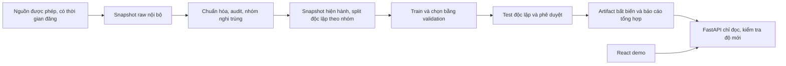

# HCM Apartment Price AI

Đồ án AI: **ước tính giá rao bán căn hộ hiện tại tại TPHCM**, nhóm 6 người trong 4 tuần. [Repository public](https://github.com/KhiemPham1512/hcm-apartment-price-ai). Không gọi đầu ra là giá giao dịch thực tế hoặc dự báo tương lai.

## Chỉ cần đọc những file nào?

1. **README này:** hướng dẫn chạy, kiến trúc, hợp đồng dữ liệu/API, AI, nguồn nghiên cứu và vận hành. Đây là nguồn chuẩn kỹ thuật duy nhất.
2. **[docs/SPEC.md](docs/SPEC.md):** bài toán, user stories và nghiệm thu.
3. **[docs/TEAM.md](docs/TEAM.md):** nhận việc theo 6 thành viên và từng tuần.
4. **[AGENTS.md](AGENTS.md):** quy tắc GitHub/nhánh/review cho người và agent.

Các tài liệu rời trước đây đã được gộp vào đây và xóa. Nội dung tham khảo dài được thu gọn trong các mục bên dưới. Không tạo lại glossary/ADR/research/contracts riêng cho cùng nội dung. File Word đề gốc được giữ nguyên tại máy nhóm; nội dung liên quan được trích ở cuối README.

### Code hiện có: mở đúng phần mình làm

| Vai trò | Điểm vào code | Trách nhiệm hiện tại |
| --- | --- | --- |
| TV1 | [schema](ml/schema.py), [data](ml/data.py) | CSV đã chuẩn hóa, timestamp, đại diện nhóm/split; chưa có adapter raw |
| TV2 | [models](ml/models.py), [train](ml/train.py) | Factory chung của ba mô hình, preprocessing và chọn validation |
| TV3 | [models](ml/models.py) qua phối hợp TV2 | Tham số cây đã có; tiếp theo làm analysis/importance trong module riêng khi nhận issue |
| TV4 | [HTTP](backend/app.py), [serving](backend/service.py) | Schema, readiness/freshness, loader và output guards |
| TV5 | [hợp đồng HTTP](#api) | Chưa có frontend; bắt đầu từ contract và API thật, không cần đọc hết ML |
| TV6 | [evaluate](ml/evaluate.py), [tests](tests/test_ml.py), [CI](.github/workflows/checks.yml) | Holdout, evidence và kiểm tra tích hợp |

`ml/models.py` hiện là file chung do TV2 điều phối; TV3 không cùng ghi file đó trên nhánh khác khi chưa phối hợp. Cấu trúc sâu phía dưới là thiết kế đích, không phải danh sách file rỗng cần tạo ngay.

## Bắt đầu triển khai

Đang xây nền Python/ML/API; **chưa có dữ liệu thị trường được xác minh, model được duyệt hoặc số đo độ chính xác thị trường**. Các test dùng fixture giả chỉ kiểm tra kỹ thuật. API thiếu model phải trả 503, không trả giá giả. Frontend và release đầy đủ vẫn là công việc tiếp theo, không mặc định các phần thiết kế dưới đây đã được triển khai.

Python 3.12, PowerShell tại thư mục repo:

```powershell
python -m venv .venv
.venv/Scripts/python.exe -m pip install -r requirements-dev.lock
.venv/Scripts/python.exe -m pip install --no-deps --no-build-isolation -e .
.venv/Scripts/python.exe -m pytest -q
.venv/Scripts/python.exe -m ruff check .
.venv/Scripts/python.exe -m uvicorn backend.app:app --host 127.0.0.1 --port 8000 --no-proxy-headers
```

Xem `/docs` để thử HTTP schema; `/health/live` báo process sống, `/health/ready` chỉ 200 khi có model được duyệt và còn hạn. Linux/macOS thay đường dẫn Python bằng `.venv/bin/python`. Exact dependencies dùng lockfile trong repo, không dùng Python/site-packages toàn máy.

CLI đã có: `python -m ml.train --help` và `python -m ml.evaluate --help`. Train chỉ chọn bằng validation; evaluate là thao tác riêng mở holdout, từ chối ghi đè report hoặc holdout/split đã bị sửa. Root npm dành cho công cụ Git hooks, chưa là frontend.

```powershell
.venv/Scripts/python.exe -m ml.train --csv data/processed/current.csv --dataset-card data/processed/card.json --output artifacts/run-001
.venv/Scripts/python.exe -m ml.evaluate --run-dir artifacts/run-001
```

Các đường dẫn dữ liệu ở trên do TV1 bàn giao, không có data thị trường kèm repo. Card đầu vào giai đoạn nền theo `DatasetCard` trong code: dataset_version, data_kind (real/synthetic), license_reference, source_verified, geography_version, grouping_version, district_labels. Đây chưa thay toàn bộ manifest/review phát hành phía dưới. Output vẫn candidate; chưa có lệnh tự duyệt release.

Kiểm tra nền: 34 test kỹ thuật pass, Ruff và dependency check pass trên Python 3.12; test CLI dùng dữ liệu giả có nhãn rõ. CI đã cấu hình, cần kiểm tra run thực trên GitHub sau upload; rate/concurrency/timeout public và UI chưa được triển khai.

## GitHub và SSOT

[GitHub Issues](https://github.com/KhiemPham1512/hcm-apartment-price-ai/issues) là tracker; TEAM giữ phân công/mốc, không tạo task/spec bản sao. Một issue/một owner/một nhánh từ `main`, draft PR sớm, không force-push lịch sử đã chia sẻ; cập nhật bằng merge `origin/main`; CI xanh và reviewer khác tác giả trước squash merge. Bootstrap repo rỗng có thể có commit khởi tạo README rồi commit phần nền. Chi tiết quyền file và phối hợp ở AGENTS/TEAM.

**Quy tắc đọc:** hợp đồng dữ liệu/AI/HTTP dưới đây là quyết định hiện hành; research chỉ cung cấp bằng chứng hoặc lựa chọn đã cân nhắc. Không sao chép giới hạn vào spec/task/UI thành bản chuẩn thứ hai. Khi có code, schema thực thi dùng chung và contract Markdown cập nhật trong cùng PR. Các giá trị minh họa, template và thiết kế chưa chạy không phải kết quả thực nghiệm.

## Mục lục kỹ thuật

- [Kiến trúc](#kien-truc)
- [Hợp đồng dữ liệu](#du-lieu)
- [Giao thức AI](#ai)
- [Hợp đồng HTTP](#api)
- [Bảo mật và phân quyền](#bao-mat)
- [Thuật ngữ](#thuat-ngu)
- [Quyết định: phạm vi giá rao](#qd1)
- [Quyết định: ML offline và HTTP chỉ đọc](#qd2)
- [Quyết định: snapshot và test độc lập](#qd3)
- [Chất vấn và các cổng chưa có bằng chứng](#phan-bien)
- [Nghiên cứu AI và nguồn primary](#nghien-cuu-ai)
- [Nguồn dữ liệu và điều kiện sử dụng](#nguon-du-lieu)
- [Căn cứ công nghệ ứng dụng](#nghien-cuu-stack)
- [Vận hành và phát hành](#van-hanh)
- [Quy ước code và Definition of Done](#quy-uoc-code)
- [Nội dung dataset card khi có dữ liệu](#dataset-card)
- [Nội dung model card khi có mô hình](#model-card)
- [Báo cáo môn học và người viết](#bao-cao)
- [Trạng thái pre-commit](#pre-commit)
- [Nội dung đề tài gốc](#de-goc)


<a id="kien-truc"></a>
<details>
<summary><strong>Kiến trúc</strong></summary>

Owner: TV6. Quyết định chính: [ADR-0002](#qd2). Cấu trúc mục tiêu; xem SPEC để biết phần đã có code.



## Stack được chọn

| Phần | Công nghệ | Lý do trong bối cảnh đồ án |
| --- | --- | --- |
| Dữ liệu | Python 3.12, pandas, NumPy; CSV/Parquet | Dễ kiểm tra, không cần DB cho snapshot và batch training |
| AI | scikit-learn; matplotlib/seaborn; joblib nội bộ | Đủ ba mô hình yêu cầu, pipeline và giải thích trực tiếp |
| API | FastAPI, Pydantic, Uvicorn | Schema và validation có kiểu; phục vụ pipeline Python dùng chung |
| Web | React, TypeScript, Vite, CSS đơn giản | Một form, trạng thái lỗi, báo cáo; không thêm framework server-rendering |
| Kiểm thử | pytest; TypeScript typecheck; Playwright smoke | Kiểm tra tính toán, hợp đồng và luồng demo |
| Chất lượng | Ruff cho Python; Prettier/lint-staged/Husky cho file phù hợp | Không ép Prettier định dạng Python |
| Phát hành | Máy nhóm chạy local là phương án bắt buộc; Docker image là tùy chọn | Demo được ngay cả khi cloud/mạng gặp lỗi |

Không thêm Supabase, PostgreSQL, Redis, Kafka hoặc vector DB vì không có truy vấn giao dịch, tài khoản hay tác vụ queue trong MVP. Không thêm deep learning/LLM chỉ để mang nhãn AI: ba kỹ thuật trọng tâm đã có trong đề bài. Việc chọn package version chính xác thực hiện ngày 1 sau cài và kiểm tra tương thích; commit lockfile, dùng cùng environment cho train và serve. Node LTS tương thích Vite, chọn một bản cho cả nhóm, không dùng “máy em latest” làm chuẩn.

## Ranh giới dự kiến của monorepo

```text
docs/                   hợp đồng, research, quyết định
contracts/              features.json và OpenAPI snapshot sinh khi có code
data/reference/         danh mục khu vực có nguồn, không có PII
data/raw/               snapshot riêng tư, không commit
data/processed/         dữ liệu sạch và splits, không commit dữ liệu thật
ml/                     Python package training/inference
  data/                 adapters, clean, group, split
  features.py           preprocessor duy nhất dùng chung
  models/               linear.py, polynomial.py, tree.py
  prepare.py            CLI dữ liệu
  train.py              CLI fit và chọn validation
  evaluate.py           CLI test do TV6 chạy
  release.py            kiểm tra cổng, đóng gói ứng viên
backend/app/            FastAPI và Pydantic; import ml
frontend/               React/TS; chỉ gọi HTTP contract
tests/                  data/ML/integration tests với fixture đã ẩn danh
artifacts/              artifact nội bộ được duyệt, không commit binary
reports/                kết quả tổng hợp đã kiểm tra quyền và riêng tư
```

TV6 tạo `pyproject.toml` ở root để cài chung `ml`/`backend`, tránh copy Python module hoặc sửa `sys.path` tùy máy. Frontend có `frontend/package.json`; root package hiện có phục vụ công cụ Git hooks. Các lệnh scaffold phải giữ root config và tài liệu hiện có.

## Luồng phục vụ

Khi khởi động, backend xác minh metadata, schema, hash và trạng thái phê duyệt trước khi nạp pipeline đáng tin cậy; nạp một lần, không đọc theo path người dùng cung cấp. HTTP request → validate → kiểm tra readiness/freshness/phạm vi → một pipeline predict → kiểm tra đầu ra → response với version/ngày dữ liệu. Không tính lại encoder/imputer trong route hoặc JavaScript.

UI lấy danh mục từ `/api/v1/metadata`, gửi request theo hợp đồng, không tự nhân giá khi đổi đơn vị đầu vào. `/api/v1/report` trả bản thống kê đã duyệt. Backend không mount thư mục raw, artifact hoặc notebook ra public.

## Dữ liệu và vận hành

Không lưu lịch sử dự đoán trong MVP; request log chỉ gồm request ID, latency, status, model version và lỗi có mã. Snapshot và artifact lưu ở thư mục nhóm kiểm soát quyền đọc/ghi, không dùng public drive link. Có backup chỉ đọc và manifest checksum; chỉ số liệu đã tổng hợp/ẩn danh mới vào báo cáo công khai.

Không yêu cầu cloud trả phí. Nếu cần URL demo, TV6 chọn host hỗ trợ Python đủ RAM sau khi đo một artifact thật, HTTPS và proxy giới hạn request; không ràng buộc một nhà cung cấp chưa thử. Không dựa vào free tier hoặc chi phí chưa xác minh. Theo [runbook](#van-hanh), luôn có demo local và video quay từ hệ thống thật còn freshness phù hợp.

</details>

<a id="du-lieu"></a>
<details>
<summary><strong>Hợp đồng dữ liệu</strong></summary>

Owner: TV1. Reviewer: TV2 và TV6. Đây là nguồn chuẩn cho đơn vị, tên trường, phạm vi đầu vào và độ mới. Không phải mô tả một dataset đã có.

## Nhãn và phạm vi

- Nhãn duy nhất: `asking_price_vnd`, tổng giá rao **bán** toàn bộ căn hộ; tiền VND. Thuê, trả góp theo tháng, giá mỗi m² chưa quy đổi, giá “thỏa thuận”, giao dịch không rõ loại đều bị loại hoặc cách ly để xác minh.
- `property_type = apartment`, `listing_type = sale` là trường kiểm tra phạm vi, không phải đặc trưng cho mô hình trong MVP một loại.
- MVP ưu tiên một nguồn chính qua gate, không ghép thêm nguồn để tăng số mẫu trước khi kiểm tra quyền, đơn vị và trùng liên nguồn. `source_id` vẫn lưu để truy vết và hỗ trợ adapter mở rộng về sau.
- Phạm vi địa lý theo ADR-0001. Dùng `district_code` của bộ ánh xạ lịch sử `hcm_pre2025_v1`; mã là slug nội bộ, không giả làm mã hành chính hiện hành. TV1 tạo danh mục có nguồn trong `data/reference/districts.csv` ngày 2. Không dùng phép tìm chữ “HCM” để nhận toàn bộ dữ liệu sau sáp nhập.
- Phải phân biệt diện tích sử dụng/thông thủy và diện tích xây dựng. Chỉ dùng một cách đo được xác minh hoặc một nhóm nhất quán; `area_basis` phải được ghi trong dataset card và artifact. Nếu nguồn không rõ, ghi `source_reported_unknown`, audit và nêu giới hạn; không tuyên bố hai cách đo tương đương.

## Các trường chuẩn

| Trường | Kiểu / đơn vị | Bắt buộc trong dữ liệu sạch | Dùng làm X? | Quy tắc |
| --- | --- | --- | --- | --- |
| `listing_id` | string | Có | Không | ID nguồn; không chứa số điện thoại |
| `source_id` | string | Có | Không | Khóa nguồn đã được phép dùng |
| `property_group_id` | string | Có | Không | Nhóm nghi cùng căn; do pipeline gộp trùng tạo |
| `published_at` | ISO-8601 có timezone | Có | Không | Thời gian đăng đã xác minh; không dùng ngày tải file để điền |
| `price_observed_at` | ISO-8601 có timezone | Có | Không | Thời điểm nguồn/bản chụp xác nhận chính mức giá trong dòng; không suy từ ngày đăng nếu giá đã sửa |
| `source_snapshot_at` | ISO-8601 có timezone | Có | Không | Thời điểm lấy snapshot nguồn |
| `active_at_snapshot` | boolean, phải true | Có | Không | Nguồn/export có bằng chứng tin còn rao bán khi chụp snapshot |
| `availability_evidence_id` | string | Có | Không | Tham chiếu bằng chứng lọc tin đang bán trong kho nội bộ; không chứa PII |
| `district_code` | string từ danh mục | Có | Có | Khu vực nghiên cứu; khi serving phải thuộc danh sách hỗ trợ |
| `area_m2` | số hữu hạn, m² | Có | Có | Từ 10 đến 500, bao gồm hai đầu |
| `bedrooms` | integer hoặc null | Không | Có | 0–10; 0 có thể là studio, null là không biết |
| `bathrooms` | integer hoặc null | Không | Có | 0–10; không thay null bằng 0 |
| `floor_level` | integer hoặc null | Không | Có | 0–100; chỉ tầng căn hộ, không phải số tầng cả tòa |
| `asking_price_vnd` | số hữu hạn dương, VND | Có | **y** | Bắt buộc xác minh tổng giá; không làm X |
| `property_type` | literal `apartment` | Có | Không | Loại khác ngoài MVP |
| `listing_type` | literal `sale` | Có | Không | Không trộn tin thuê |
| `area_basis` | enum theo dataset card | Có | Không | Một quy ước diện tích nhất quán cho mỗi phiên bản |
| `project_name_normalized` | string hoặc null | Không | Không | Chỉ hỗ trợ gộp trùng và phân tích tập trung dự án |

Phạm vi số ở trên là giới hạn MVP do nhóm chọn, không phải phát biểu về toàn bộ thị trường. Căn hộ ngoài phạm vi không nên ép về giá trị biên. Phải đếm và báo tỷ lệ bị loại; không thay giới hạn sau khi xem lỗi test. Nếu một cột tùy chọn thiếu toàn bộ trong train, bỏ khỏi feature set bằng một phiên bản hợp đồng mới trước khi freeze, không âm thầm đổi pipeline.

`price_per_m2_vnd = asking_price_vnd / area_m2` chỉ phục vụ EDA/kiểm tra/hiển thị. Không được đưa vào X vì có nhãn giá. Không đưa ID, URL, điện thoại, tên người bán, nguyên văn mô tả hoặc địa chỉ căn cụ thể vào X.

## Độ mới — cấu hình chuẩn duy nhất

| Tên | Giá trị MVP | Ý nghĩa |
| --- | --- | --- |
| `recent_window_days` | 90 ngày | Giữ tin có `published_at` trong `[T-90 ngày, T]`, T là snapshot; đây là giới hạn tuổi tin, không phải bằng chứng có lịch sử giá |
| `publication_max_snapshot_age_days` | 7 ngày | Khi phát hành, snapshot nguồn không cũ hơn mức này |
| `publication_max_data_age_days` | 7 ngày | Khi phát hành, từng mức giá trong snapshot hiện hành phải được quan sát trong khoảng này |
| `serving_max_data_age_days` | 14 ngày | Quá hạn này API không trả giá với nhãn hiện tại |
| `refresh_interval_days` | 7 ngày | Nhóm chuẩn bị snapshot và ứng viên cập nhật, không tự động bỏ qua cổng đánh giá |
| `min_train_groups_per_district` | 20 nhóm | Khu vực ít hơn mức này không được phục vụ |

`data_as_of = min(price_observed_at)` của snapshot hiện hành dùng cho phát hành: đây là mốc bảo thủ để không dùng một tin mới che các mức giá cũ. Lưu thêm `data_latest_at = max(price_observed_at)`. Luôn `published_at <= price_observed_at <= source_snapshot_at <= now`; không tạo `price_observed_at` bằng thời điểm tải lại CSV cũ. Export hiện hành do nguồn xác nhận giá/active tại T có thể dùng T cho thời điểm quan sát giá, nhưng không được giả tạo lịch sử giá trước T.

Manifest/API bắt buộc có `age_summary = {median_listing_age_days, median_price_age_days, computed_at}` để UI công bố tuổi tin và tuổi quan sát giá. `data_window_start/end` là min/max của `price_observed_at` trong snapshot hiện hành; `listing_window_start/end` là min/max của ngày đăng. `evaluation_window_start/end` riêng cho dữ liệu đánh giá; ba khoảng này không được dùng thay nhau. Kiểm tra phân bố tuần và tập trung dự án: dữ liệu mới không tự bảo đảm đại diện thị trường.

Tính thời gian bằng UTC có timezone; hiển thị theo `Asia/Ho_Chi_Minh`. So sánh bằng khoảng thời gian thực, không chỉ so chuỗi ngày. Timestamp tương lai hoặc không rõ nguồn → cách ly. Giới hạn bằng đúng ngưỡng vẫn hợp lệ. Chỉ thay các cấu hình này qua PR hợp đồng; không sửa riêng frontend để tránh báo hết hạn.

## Pipeline chuẩn hóa và gộp trùng

1. Lưu bản raw bất biến có checksum, license/permission, source snapshot và bằng chứng còn rao bán (ví dụ export được chủ dữ liệu xác nhận chỉ gồm tin active). Không có bằng chứng trạng thái active thì không đủ điều kiện cho snapshot hiện tại; không tự điền true chỉ từ ngày đăng. Raw có dữ liệu nhận dạng không được vào Git/public artifacts.
2. Chuẩn hóa dấu, đơn vị tỷ/triệu/nghìn, dấu thập phân và nghìn theo nguồn. Có fixture cho “3,2 tỷ”, giá/m², giá thuê. Giá hoặc diện tích không chắc nghĩa → quarantine, không đoán.
3. Lọc phạm vi và tính hợp lệ theo quy tắc định trước; lưu reason code và số lượng. Không loại giá cao chỉ vì mô hình dự đoán kém.
4. Gộp trùng chắc chắn theo ID nguồn/URL chuẩn hóa; giữ phiên bản cập nhật hợp lệ gần nhất. Với liên nguồn, dùng dự án/khu vực, diện tích, phòng, tầng và mô tả đã loại thông tin cá nhân cùng biểu thức giá để tạo nhóm nghi trùng, audit thủ công cả false merge và missed match. Không dùng giá nhãn hoặc residual để quyết định group. Cùng diện tích/quận chưa đủ để kết luận cùng căn.
5. Lưu `grouping_version`, lý do ghép và báo cáo audit. Thiếu số căn/địa chỉ chính xác thì không thể cam kết nhận diện toàn bộ trùng lặp; nêu đây là hạn chế của nghiên cứu.
6. Tạo split và chọn bản đại diện theo [AI protocol](#ai); các biến đổi học từ dữ liệu phải nằm trong pipeline train.

## Manifest dataset bắt buộc

`dataset_version`, raw/clean SHA-256, source revisions, `source_snapshot_at`, `data_as_of`, `data_latest_at`, các cửa sổ và `age_summary` định nghĩa trên, timezone, license/permission reference, area basis, geography/grouping/schema versions, số dòng raw/quarantine/clean, số nhóm, bảng lý do loại, missingness, phân bố thời gian/khu vực, nồng độ dự án, phương pháp audit và người duyệt. Không có manifest thì dataset chưa được bàn giao.

</details>

<a id="ai"></a>
<details>
<summary><strong>Giao thức AI</strong></summary>

Owner: TV2. Người giữ test và reviewer độc lập: TV6. Áp dụng REQ-02/03/04/05. Các mức thời gian và miền đặc trưng chỉ đọc từ [hợp đồng dữ liệu](#du-lieu).

## Câu hỏi nghiên cứu

Với các căn hộ đang rao trong cùng snapshot hiện hành, ba dạng mô hình tuyến tính, đa thức và cây quyết định ước tính giá của các nhóm căn hộ chưa dùng để fit tốt đến đâu? Mô hình nào giảm sai số ngoài mẫu khi đã ngăn trùng căn hộ qua các tập? Diện tích/vị trí đóng góp gì? Dự đoán kỳ giá tương lai là câu hỏi riêng, chỉ đánh giá khi có lịch sử quan sát giá thật.

Không coi một dự đoán là bằng chứng bán được, không kiểm chứng giá giao dịch hoặc dự báo thị trường tương lai.

## Tập dữ liệu và split bắt buộc

**Thiết kế A — mặc định MVP: `current_snapshot_grouped`.** Snapshot nguồn xác nhận giá và trạng thái đang bán tại thời điểm quan sát theo data contract. Ngày đăng cũ không có nghĩa mức giá hiện tại đã tồn tại từ ngày đó. Vì vậy không chia theo `published_at` rồi gọi là dự đoán giá tương lai.

Chuẩn hóa và tạo `property_group_id` không dùng y. Mỗi nhóm giữ một tin đại diện có `price_observed_at` mới nhất; hòa thì `published_at` mới nhất, rồi `source_id`, `listing_id` theo từ điển. Ghi lý do loại, audit false merge/missed match; không dùng giá chọn đại diện. Dùng `GroupShuffleSplit` seed 42 để lấy 15% nhóm làm test; trên 85% còn lại lấy tỷ lệ `15/85` nhóm làm validation, còn lại train. Tỷ lệ mục tiêu 70/15/15 theo **nhóm**, làm tròn nên phải ghi n thực. Không dùng giá để chia; giữ cùng split cho B0/M1/M2/M3.

Assert nhóm đôi một rời nhau, ID duy nhất và mọi dòng đúng phạm vi/freshness. Lưu `splits.csv` với ID, group, split, timestamps, seed và checksum, không chỉ seed. TV1 đề xuất nhóm, TV6 duyệt. Ngưỡng dữ liệu tổ chức nằm trong [spec](docs/SPEC.md). Kết quả A chỉ chứng minh khả năng ước tính trên căn hộ giữ lại trong snapshot hiện hành cùng phân phối nguồn, **không** chứng minh khả năng dự báo thị trường tương lai hoặc dự án hoàn toàn mới.

**Thiết kế B — mở rộng có điều kiện: `temporal_price_group_purged`.** Chỉ dùng khi có archive nhiều lần quan sát giá đáng tin, không dựng lịch sử bằng ngày đăng. Snapshot hiện hành và archive lịch sử có version tách biệt; archive không được dùng để lách freshness khi phục vụ. Khóa cutoff theo `price_observed_at` trước khi xem y; train cũ hơn validation và test. Nếu một nhóm xuất hiện nhiều kỳ, giữ ở kỳ muộn nhất và purge khỏi kỳ sớm; đại diện trong mỗi nhóm chọn theo quy tắc thời gian ở trên. Assert cả group disjoint và chronology. Cutoff cụ thể phải chốt trong config và manifest trước chạy, không tự định nghĩa từ `published_at`. Báo cáo B tách khỏi A, không gộp điểm hai thiết kế.

Không dùng test để fit scaler/imputer/encoder, tính ngưỡng outlier học từ dữ liệu, chọn feature, log target, độ cây, bậc đa thức hoặc chọn winner. Thư mục test do TV6 quản lý đến vòng đánh giá; mô tả schema và số mẫu được chia sẻ, nhãn không đưa vào notebook tune. Sau khi đã mở test mà chỉnh mô hình, kết quả cũ chỉ là exploratory; muốn kết luận mới phải có một test tương lai chưa đụng đến hoặc công bố không còn holdout độc lập.

Holdout dự án là kiểm tra phụ nếu còn thời gian, đặt tên riêng. Không đổi thiết kế A sang B hoặc ngược lại chỉ vì điểm số đẹp hơn; phải có bằng chứng phù hợp với câu hỏi đánh giá.

Khi refresh, test mới không được chứa nhóm từng fit/train, tune, hoặc đã mở nhãn đánh giá trước đó. Chi tiết sổ theo dõi ở [runbook](#van-hanh). Có run ID mới hoặc timestamp mới không tự tạo ra một holdout độc lập mới.

## Pipeline chung và mô hình

Feature set theo [data contract](#du-lieu). Dùng pandas để kiểm tra/tải bảng; `ColumnTransformer` và `Pipeline` đảm bảo preprocessing nằm cùng estimator. Numeric median imputation chỉ fit train; numeric scale cho linear/poly. Category district dùng one-hot, không áp đặt thứ tự số cho vị trí. `OneHotEncoder(handle_unknown="ignore")` giúp pipeline không vỡ, nhưng API vẫn từ chối khu vực ngoài danh sách được hỗ trợ.

| ID | Pipeline nghiên cứu | Cấu hình được phép thử trên validation |
| --- | --- | --- |
| B0 | `DummyRegressor(strategy="median")` | Một cấu hình, bắt buộc |
| M1 | Imputer + scaler + one-hot → `LinearRegression` | Intercept mặc định; không thay bằng Ridge rồi vẫn gọi OLS |
| M2 | Numeric imputer → `PolynomialFeatures(degree=2, include_bias=False)` → scaler; categorical one-hot riêng → `LinearRegression` | Bậc 2, không polynomial toàn bộ one-hot; ghi số cột sau biến đổi |
| M3 | Numeric imputer + categorical one-hot → `DecisionTreeRegressor` | `max_depth` ∈ {3, 5, 8, 12}; `min_samples_leaf` ∈ {5, 10, 20}; `random_state=42` |

MVP chuẩn dùng nhãn VND gốc. Có thể thêm `log1p(y)` như thí nghiệm phụ cho cả ba, với inverse `expm1` trước mọi metric VND; phải chọn raw/log bằng validation trước khi mở test. Dự đoán trong log-space không tự là kỳ vọng giá trên VND, có thể có sai lệch khi biến đổi ngược. Không triển khai log target nếu còn thiếu kiểm chứng. Ridge/RandomForest/XGBoost chỉ là mở rộng, không thay ba mô hình bắt buộc.

Không đưa thời điểm tương lai, giá/m² suy từ nhãn, nội dung chứa giá vào X. Không “clean toàn bộ rồi split” nếu clean đó học ngưỡng từ y. Clip giá âm về 0 có thể che lỗi; mặc định ghi tỷ lệ dự đoán không hợp lệ và không phát hành model có trường hợp âm trong bộ kiểm tra phát hành. Nếu thử ràng buộc đầu ra phải ghi một cấu hình mới và đánh giá công bằng.

## Metric và lựa chọn

`RMSE = sqrt(mean((y - y_hat)^2))`, đơn vị VND; có thể trình bày thêm triệu VND nhưng phải đổi nhãn trục. `R² = 1 - SSE/SST`, không có đơn vị; có thể âm. Nếu tập/phân nhóm không đủ mẫu hoặc nhãn hằng, ghi `null` với reason thay vì ép thành điểm số bình thường. Thêm MAE VND để dễ giải thích; không dùng accuracy phần trăm cho hồi quy.

1. TV2/TV3 so sánh các ứng viên bằng **validation RMSE VND**. Nếu chênh lệch tương đối dưới 1%, chọn mô hình đơn giản hơn theo thứ tự M1 → M2 → M3. Đây là quy tắc nhóm chọn, không phải định lý thống kê.
2. Khóa model family, hyperparameters, preprocessing và training snapshot. Không refit trên train+validation trong MVP để giữ artifact đánh giá và serving là cùng một pipeline.
3. TV6 chạy B0, M1, M2, M3 đã khóa trên đúng test; công bố cả bảng, không đổi winner dựa test. Nếu winner thất bại, ghi kết quả, không đổi sang model có test đẹp hơn rồi gọi độc lập.
4. Báo cáo sai số theo district, nhóm diện tích, nhóm giá và thời gian; công bố n. Nhóm n<20 chỉ mô tả thận trọng, không xếp hạng hoặc suy rộng. Bootstrap theo nhóm test có thể thêm khoảng biến thiên cho **metric**, không gọi đó là khoảng dự đoán cho từng căn.

Bảng chính giữ toàn bộ test hợp lệ đã khóa, kể cả district ít dữ liệu/không xuất hiện ở train; báo tỷ lệ unknown và các trường hợp không phục vụ. Có thể thêm bảng riêng cho tập con `supported_districts` suy từ train để mô tả hành vi serving, nhưng phải ghi n/tỷ lệ bao phủ và không thay bảng chính bằng tập con dễ dự đoán hơn. Không bỏ mẫu test khó sau khi xem residual.

## Tiêu chí phát hành và rút lui

- Điều kiện nghiên cứu: đủ ba mô hình, split hợp lệ, metric và giới hạn minh bạch, chạy lại được.
- Điều kiện phát hành dự đoán hiện tại: nguồn dữ liệu được phép, freshness hợp lệ, schema đúng, model winner có RMSE test thấp hơn B0 và R² test >0, không có đầu ra NaN/Inf/không dương trong test và smoke fixtures, API/UI kiểm tra pass. Đây là điều kiện tối thiểu của nhóm, không bảo đảm giá phù hợp để quyết định tài chính.
- Khu vực được phục vụ theo ngưỡng train tại data contract. Các giá trị diện tích ngoài min/max train vẫn thuộc hard bounds: trả kết quả kèm `outside_training_range` nếu pipeline cho kết quả hợp lệ; không tuyên bố tự tin cao. Đầu vào ngoài hard bounds hoặc district không hỗ trợ → từ chối.
- Nếu không vượt baseline: giữ báo cáo học thuật, khóa tính năng ước tính public; tiếp tục điều tra trong thời gian cho phép. Nếu quá hạn dữ liệu: trả lỗi có thông tin ngày dữ liệu, không âm thầm trả một giá cũ.

## Giải thích

Permutation importance trên **validation** sau chọn ứng viên, gọi pipeline trên cột gốc và dùng scorer RMSE nhất quán; 10 lần lặp, seed 42, nêu trung bình và độ lệch chuẩn. Như vậy district là một feature, tránh đếm mỗi one-hot như một khái niệm độc lập. Nếu feature tương quan, importance có thể bị chia sẻ; cần đối chiếu EDA/ablation trên validation.

Đối chiếu coefficients của M1 với đơn vị/scale; cây có thể xuất hình giới hạn độ sâu. `feature_importances_` của cây không được dùng làm bằng chứng duy nhất. Không gọi importance là quan hệ nhân quả, không suy ra pháp lý căn hộ từ giá. MVP không trả “độ tin cậy 95%” cho một căn; muốn thêm prediction interval cần protocol calibration riêng.

## Artifact và báo cáo

Mỗi lần chạy có `run_id`, `evaluation_kind`, dataset/split hashes, schema version, git SHA hoặc source archive SHA khi chưa commit, Python/package versions, seed, config, train/validation/test counts, timestamp, metrics, số dự đoán invalid và người đánh giá. Chỉ bắt buộc cutoff/chronology khi thực sự chạy thiết kế B; thiết kế A ghi rõ snapshot và phương pháp nhóm. Báo cáo metric là số thực từ lần chạy, không điền trước vào tài liệu.

Ứng viên tạo `pipeline.joblib`, `manifest.json`, `metrics.json`, `model-card.md`, `figures/`. Manifest ghi hash artifact, data window/age, supported districts, train ranges, feature list, environment và `release_status` ∈ {`candidate`, `approved`, `rejected`}. API chỉ nạp `approved`. Joblib chỉ từ pipeline nội bộ đáng tin; hash đơn thuần không chứng minh người phát hành hợp lệ. Xem [bảo mật](#bao-mat).

Đề xuất CLI sau khi triển khai (chưa tồn tại): `python -m ml.prepare`, `python -m ml.train`, `python -m ml.evaluate`, `python -m ml.release`; chi tiết trách nhiệm ở [team plan](docs/TEAM.md).

</details>

<a id="api"></a>
<details>
<summary><strong>Hợp đồng HTTP</strong></summary>

Owner: TV4. Dùng tiền VND và feature theo [data contract](#du-lieu). Đây là thiết kế để TV4/TV5 làm độc lập; chưa có API chạy. Breaking change cần tăng version và cập nhật consumer cùng PR.

## Quy tắc chung

Base path `/api/v1`. JSON UTF-8, chỉ số hữu hạn, không ép chuỗi thành số. Pydantic phải từ chối field lạ (`extra="forbid"`) và boolean trong trường số; không nhận giá nhãn trong request. CORS chỉ origin demo đã cấu hình; không coi CORS là cơ chế phân quyền.

| Endpoint | Mục đích | Điều kiện |
| --- | --- | --- |
| `GET /health/live` | Process đang chạy | 200 không lộ paths/secrets |
| `GET /health/ready` | Model hợp lệ, approved, còn freshness | 200 khi sẵn sàng; 503 khi không đủ điều kiện |
| `GET /api/v1/metadata` | Feature/schema version, supported districts, model, data window, ngày dữ liệu, serving status | 200 kể cả stale để UI giải thích; không trả giá |
| `POST /api/v1/predictions` | Một dự đoán trên model đang approved | Không có quyền chọn path/model tùy ý |
| `GET /api/v1/report` | Kết quả thí nghiệm tổng hợp đã duyệt | 200 nếu có báo cáo, kể cả lịch sử nhưng phải có nhãn ngày; 503 nếu chưa có |

Không có endpoint upload CSV, retrain, đổi artifact, liệt kê filesystem, lấy raw hoặc tải joblib. Một model winner phục vụ; ba mô hình xuất hiện trong báo cáo, không bắt người dùng chọn model để tìm số giá mong muốn.

## Request dự đoán

Required: `area_m2`, `district_code`. Optional mặc định null: `bedrooms`, `bathrooms`, `floor_level`. Kiểu và giới hạn chỉ định nghĩa trong [bảng trường](#du-lieu), không định nghĩa bản khác ở frontend. Frontend lấy danh mục district từ metadata.

```json
{
  "area_m2": 70,
  "district_code": "quan_7",
  "bedrooms": 2,
  "bathrooms": 2,
  "floor_level": null
}
```

`quan_7` chỉ là ví dụ cú pháp; chỉ chấp nhận nếu xuất hiện trong metadata của artifact thật. Người dùng không gửi giá/m² hoặc giá tổng làm feature. Không nhận mô tả tự do, URL, địa chỉ số căn hoặc số điện thoại.

## Response 200

Các trường bắt buộc: `request_id` (opaque string), `predicted_price_vnd` (positive finite number), `predicted_price_per_m2_vnd` (number tính từ tổng giá/diện tích request), `target` (literal `asking_sale_price`), `model_id`, `run_id`, `dataset_version`, `schema_version`, `area_basis`, `warnings` (array mã). Các trường ngày bắt buộc lấy nguyên nghĩa từ data contract: `data_as_of`, `data_latest_at`, `source_snapshot_at`, `data_window_start/end`, `listing_window_start/end`, `age_summary`. Timestamp ISO-8601 UTC; đây là metadata thật của artifact, không lấy ngày hiện tại để thay.

MVP không có field `confidence`, `accuracy` hoặc khoảng tin cậy mỗi căn. Mã warning v1: `outside_training_range`, `optional_features_missing`. Không dùng warning để hợp thức hóa district không hỗ trợ hoặc dữ liệu quá hạn: hai trường hợp đó phải trả lỗi.

Trước khi trả, kiểm tra output hữu hạn và dương. Nếu model trả âm/NaN/Inf, trả 503 `prediction_unavailable`, log request ID và model version, không tự clip hay gửi traceback cho client.

## Metadata và báo cáo

Metadata trả schema/feature names, danh mục `supported_districts` với `{code,label}`, hard bounds từ data contract, `training_ranges`, `model_id`, `dataset_version`, cùng các trường ngày/`age_summary` như response dự đoán, `area_basis`, `serving_status` ∈ {`ready`,`stale`,`unavailable`}. Khi chưa có artifact, model/date/age fields có thể null và danh mục hỗ trợ rỗng.

Report trả `run_id`, `dataset_version`, `evaluation_window_start/end`, n từng split, `evaluation_kind="current_snapshot_grouped"` cho thiết kế A; chỉ dùng `temporal_price_group_purged` khi có evidence thiết kế B theo AI protocol, kèm cutoff đã khóa. Trả model winner chọn bằng validation, bảng B0/M1/M2/M3 gồm validation/test `rmse_vnd`, `mae_vnd`, `r2`, số mẫu và reason nếu metric null, importance tổng hợp cùng giới hạn. Frontend chỉ render, không tính lại metric từ dữ liệu thô. Báo cáo cũ không được đổi nhãn thành hiện tại khi model khác cập nhật.

## Lỗi

```json
{
  "error": {
    "code": "stale_model",
    "message": "Dữ liệu của mô hình đã quá hạn cập nhật.",
    "request_id": "opaque-id",
    "details": {}
  }
}
```

| Status | Code | Trường hợp |
| --- | --- | --- |
| 413 | `request_too_large` | Body vượt giới hạn |
| 415 | `unsupported_media_type` | POST không phải JSON |
| 422 | `invalid_input` | Thiếu/sai kiểu/ngoài hard bounds, extra fields |
| 422 | `unsupported_district` | Khu vực không có trong metadata |
| 429 | `rate_limited` | Quá giới hạn request |
| 503 | `model_unavailable` | Chưa có artifact approved hoặc nạp thất bại |
| 503 | `stale_model` | Quá giới hạn freshness, `details` có ngày dữ liệu |
| 503 | `prediction_unavailable` | Dự đoán không hợp lệ hoặc hết thời gian |
| 500 | `internal_error` | Lỗi không dự kiến, không lộ chi tiết nội bộ |

TV4 viết exception handler để lỗi validation dùng cùng envelope thay vì mặc định FastAPI. Không trả lại nguyên request trong `details`. Các giới hạn request và quyền chỉ định nghĩa tại [security](#bao-mat).

## Kiểm tra tích hợp bắt buộc

Hợp lệ; null optional; numeric string/boolean; extra `asking_price_vnd`; district lạ; negative/NaN/Inf; đúng biên bounds; model chưa có; stale theo clock được inject; metadata vẫn xem được khi stale; kết quả HTTP bằng pipeline offline trên cùng fixture. TV5 dùng mock sinh theo contract, TV4/TV6 kiểm tra mock và server thật trước khi merge.

</details>

<a id="bao-mat"></a>
<details>
<summary><strong>Bảo mật và phân quyền</strong></summary>

Owner: TV4, TV6 reviewer. Quyết định không có tài khoản người dùng không đồng nghĩa mọi thao tác đều được public: HTTP chỉ có đọc báo cáo, metadata và suy luận; các thay đổi dữ liệu/model là thao tác nội bộ.

## Ma trận quyền

| Hành động | Người xem demo | TV1 dữ liệu | TV2/TV3 AI | TV4 API | TV5 UI | TV6 phát hành |
| --- | --- | --- | --- | --- | --- | --- |
| Dự đoán, xem metadata/báo cáo tổng hợp | Có giới hạn | Có | Có | Có | Có | Có |
| Đọc raw thật | Không | Theo nguồn được cấp | Chỉ bản sạch cần thiết | Không mặc định | Không | Audit tối thiểu khi được cấp |
| Chuẩn bị snapshot sạch | Không | Có | Đề xuất, không ghi đè snapshot | Không | Không | Duyệt manifest |
| Huấn luyện ứng viên | Không | Không mặc định | Có | Smoke artifact đã duyệt | Không | Chạy lại để kiểm tra |
| Chọn cấu hình bằng validation | Không | Phản biện dữ liệu | Có | Không | Không | Duyệt protocol |
| Mở nhãn test cuối | Không | Theo yêu cầu audit | Sau freeze, không tune lại | Không | Không | Có, ghi run |
| Đổi model đang phục vụ | Không | Không | Đề xuất ứng viên | Phối hợp deploy | Không | Có sau kiểm tra và review |
| Sửa hợp đồng | Không | PR theo owner | PR theo owner | PR theo owner | PR đề xuất | Duyệt thay đổi liên mảng |

Đây là quyền vận hành dự kiến, phải thực thi bằng quyền repo, thư mục chia sẻ, CI/deploy credentials và review; không chỉ là cột trong tài liệu. Không dùng một tài khoản cloud/mật khẩu chung. Quyền nguồn dữ liệu có thể chặt hơn bảng này và luôn được ưu tiên. TV6 duyệt phát hành, TV4 đối chiếu manifest; không tự duyệt PR của mình mà không có reviewer khác.

## Các tình huống bị chất vấn

| Nguy cơ cụ thể | Cách ngăn / giới hạn | Bằng chứng trước demo |
| --- | --- | --- |
| Đổi ID/đường dẫn để tải dữ liệu hay artifact | Không có download/raw endpoints; fixed allowlist model path; không mount thư mục riêng tư | Test routes và kiểm tra file server |
| Upload model giả để thực thi mã | Không nhận upload; chỉ artifact nội bộ đã review, filesystem read-only lúc serve | Nạp artifact từ trusted build và kiểm tra metadata/hash |
| Đầu độc training bằng tin giả/thuê lẫn bán | Nguồn có phép, audit, thống kê shift và loại tin, snapshot bất biến | Dataset card và audit mẫu |
| DDoS/CPU/RAM bằng payload lớn hoặc nhiều request | Giới hạn body, request rate, timeout, một mẫu mỗi request; không polynomial theo user degree | Kiểm tra payload lớn và tải nhỏ có kiểm soát |
| Hiện giá cũ như giá hôm nay | Freshness gate từ metadata, không lấy ngày máy chủ thay ngày nhãn | Test thời điểm biên/quá hạn |
| API trả giá âm hoặc lỗi nội bộ | Kiểm tra output; mã lỗi cố định; log request ID | Fixture lỗi model và exception handling |
| Lộ seller PII trong logs/report | Không thu điện thoại/tên người bán vào bản sạch; không log raw request; báo cáo aggregate | Review sample logs, bundle frontend và reports |
| Frontend có khóa admin hoặc bỏ qua validation | Không có admin secret trong browser; server validate toàn bộ | Kiểm tra env/bundle, gọi API trực tiếp |
| CORS bị nhầm thành quyền truy cập | Không dựa vào CORS cho dữ liệu nhạy cảm; internal ops không nằm trên public API | Thử curl ngoài browser; không có write route |
| Metric đẹp do tin trùng hoặc sửa test | Split manifest, group disjoint, freeze, TV6 giữ test | Assert nhóm và lịch sử run; chronology nếu thiết kế thời gian |

## Cấu hình giới hạn do nhóm chọn

- Public POST tối đa 16 KiB JSON, một căn hộ/request. Inference timeout 5 giây, timeout không giết được tính toán tùy cách chạy: TV4 phải dùng giới hạn concurrency và đo thực tế, không chỉ đặt frontend timeout.
- Mặc định demo public: 30 predictions/phút/IP, burst tối đa 5; trả 429 kèm `Retry-After`. Nếu dùng proxy, chỉ tin forwarded headers từ proxy đã khai báo; không lấy IP từ header tùy ý. Local demo không public vẫn kiểm tra schema/output.
- HTTPS khi public, origin allowlist, không wildcard credentials. Không có cookie đăng nhập trong MVP. Sau này thêm auth phải có ADR và ma trận quyền mới, không chỉ ẩn nút UI.
- Log vận hành không chứa body hoặc PII; giữ tối đa 7 ngày trong môi trường demo, phân quyền đọc; che IP nếu không cần lưu. Dữ liệu nghiên cứu theo license/permission riêng, không dùng chính sách log để quyết định quyền giữ dữ liệu.
- Không đưa secrets vào Git, Vite public env hoặc notebook. Credentials deploy do TV6 quản lý, cấp tối thiểu và có thể thu hồi.

Joblib/pickle có thể thực thi mã khi load; checksum chỉ giúp phát hiện thay đổi so với manifest đáng tin, không biến file bất kỳ thành an toàn. Không hỗ trợ upload model từ user. [Tài liệu scikit-learn về model persistence](https://scikit-learn.org/stable/model_persistence.html).

HTTPS, validation, hạn chế methods, bảo vệ management endpoints và không lộ lỗi nội bộ theo [OWASP REST Security](https://cheatsheetseries.owasp.org/cheatsheets/REST_Security_Cheat_Sheet.html). Các số giới hạn phía trên là quyết định MVP cần thử nghiệm, không phải thông số OWASP bảo đảm.

</details>

<a id="thuat-ngu"></a>
<details>
<summary><strong>Thuật ngữ</strong></summary>

Ngôn ngữ chung cho đồ án ước tính giá căn hộ từ các tin rao bán. Phân biệt số tiền người bán chào với số tiền mua bán đã hoàn tất.

## Language

**Căn hộ**:
Đơn vị nhà ở riêng biệt trong tòa nhà chung cư, thuộc phạm vi giao dịch mua bán của đề tài.
_Avoid_: Nhà riêng, đất nền, phòng trọ, officetel chưa phân loại.

**Tin rao bán**:
Thông tin chào bán một căn hộ với giá và thuộc tính được công bố tại một thời điểm; không phải bằng chứng giao dịch đã hoàn thành.
_Avoid_: Giao dịch, hợp đồng mua bán, tin thuê.

**Giá rao bán**:
Tổng số tiền người đăng tin yêu cầu cho toàn bộ căn hộ tại thời điểm ghi nhận.
_Avoid_: Giá giao dịch, giá thuê, giá mỗi mét vuông khi nói về tổng giá.

**Giá giao dịch**:
Số tiền các bên thống nhất trong một giao dịch mua bán đã hoàn tất.
_Avoid_: Giá rao bán, giá mô hình.

**Giá ước tính**:
Giá rao bán được mô hình suy ra cho căn hộ có các thuộc tính đầu vào; không phải cam kết có thể mua hoặc bán ở số tiền đó.
_Avoid_: Giá chính xác, giá được bảo đảm, định giá pháp lý.

**Đơn giá diện tích**:
Giá rao bán chia cho diện tích căn hộ, dùng để diễn giải mức giá trên một đơn vị diện tích.
_Avoid_: Tổng giá, giá đầu vào độc lập khi đã biết tổng giá.

**Nhóm căn hộ nghi trùng**:
Tập tin có căn cứ cho rằng cùng nói về một căn hộ, kể cả khi được đăng lại hoặc xuất hiện ở nhiều nguồn.
_Avoid_: Cùng dự án, cùng quận, cùng diện tích là chắc chắn cùng căn.

**Dự án chung cư**:
Cụm công trình có tên nhận diện chung, có thể chứa nhiều căn hộ khác nhau.
_Avoid_: Một căn hộ, một tin đăng.

**Khu vực nghiên cứu**:
Phạm vi TPHCM trước đợt sắp xếp cấp tỉnh năm 2025, được giữ cố định để so sánh các căn hộ trong đồ án.
_Avoid_: Toàn bộ TPHCM mở rộng hiện nay.

**Ngày dữ liệu**:
Mốc quan sát giá bảo thủ cho bộ dữ liệu hiện hành, thể hiện mức độ mới của giá được dùng cho một kết quả.
_Avoid_: Ngày tải file, ngày huấn luyện, ngày xem website.

**Thời điểm quan sát giá**:
Thời điểm một mức giá cụ thể được xác nhận đang được rao, có thể khác ngày đăng tin ban đầu.
_Avoid_: Ngày đăng mặc định là ngày của mọi lần sửa giá.

**Cửa sổ dữ liệu**:
Khoảng thời gian đăng tin mà một bộ dữ liệu nghiên cứu bao phủ.
_Avoid_: Toàn bộ lịch sử thị trường.

**Ước tính hiện tại**:
Ước tính dựa trên bộ dữ liệu gần đây còn đạt điều kiện cập nhật của dự án, luôn đi kèm ngày dữ liệu.
_Avoid_: Giá thời gian thực, giá giao dịch vừa chốt.

**Khu vực được hỗ trợ**:
Khu vực thuộc phạm vi nghiên cứu và có đủ dữ liệu huấn luyện theo điều kiện công bố của mô hình.
_Avoid_: Mọi quận đều dự đoán được.

</details>

<a id="qd1"></a>
<details>
<summary><strong>Quyết định: phạm vi giá rao</strong></summary>

# Giá rao bán căn hộ gần đây trong một phạm vi địa lý cố định

Đề gốc rộng đến nhà/đất; nhóm chỉ có 4 tuần và người dùng đã đồng ý thu hẹp căn hộ, sau đó yêu cầu giá hiện tại. Chọn ước tính tổng giá rao bán căn hộ bằng dữ liệu gần đây, trong khu vực TPHCM trước sáp nhập 2025. Giá rao bán là nhãn có thể tiếp cận; không được gọi thành giá giao dịch khi không có chứng từ tương ứng.

Không chọn gộp nhà, đất, căn hộ vì ý nghĩa diện tích và cơ chế giá khác nhau, làm tăng yêu cầu dữ liệu và đánh giá phân nhóm. Không thay địa giới cùng lúc với thời điểm dự đoán: “hiện tại” chỉ thay yêu cầu thời gian, không tự mở rộng khu vực đã thống nhất. Ràng buộc cập nhật nằm tại [hợp đồng dữ liệu](#du-lieu).

Đánh đổi: MVP có thể bị chặn nếu không có dữ liệu gần đây có quyền sử dụng; dữ liệu cũ không được dùng như một cách lách yêu cầu. TV6 vẫn phải đối chiếu với giảng viên vì đề gốc ghi nhà/đất.

</details>

<a id="qd2"></a>
<details>
<summary><strong>Quyết định: ML offline và HTTP chỉ đọc</strong></summary>

# Huấn luyện offline, một dịch vụ dự đoán chỉ đọc

Chọn monorepo Python cho dữ liệu/ML/API, React cho demo; huấn luyện và phê duyệt artifact ngoài HTTP service. Không mở upload, retrain hoặc đổi mô hình từ trình duyệt. Dữ liệu và báo cáo là file có version thay vì triển khai thêm database, queue và MLflow server trong 4 tuần.

Một Python package dùng chung preprocessing và inference để tránh hai cách tính đặc trưng. Đánh đổi là phát hành mô hình theo quy trình nội bộ thay vì tự phục vụ; đổi lại giảm bề mặt tấn công và thời gian tích hợp. Nếu cần tài khoản hoặc quản trị từ xa, phải thiết kế lại quyền và lưu trữ trong ADR mới trước khi thêm endpoint.

</details>

<a id="qd3"></a>
<details>
<summary><strong>Quyết định: snapshot và test độc lập</strong></summary>

# Giá của snapshot hiện hành và giới hạn của test độc lập

Chọn test độc lập theo nhóm căn hộ trên snapshot giá rao hiện hành làm thiết kế mặc định. “Hiện tại” được chứng minh bằng nguồn, thời điểm quan sát giá và trạng thái active, không bằng cách gắn ngày đăng cũ cho mức giá đã được cập nhật. Đánh giá này đo tổng quát hóa sang căn hộ giữ lại trong snapshot, không chứng minh dự báo kỳ thị trường tương lai.

Không chọn temporal split theo ngày đăng vì nguồn có thể sửa giá sau ngày đó, gây hiểu sai thời gian của nhãn. Temporal evaluation là nhánh mở rộng chỉ khi có archive quan sát giá thật theo thời gian; phải purge nhóm và kiểm tra chronology. Giữ cùng các tập cho ba mô hình, chọn bằng validation rồi khóa trước test. Đánh đổi: không tuyên bố dự báo tương lai, nhưng thiết kế khả thi hơn khi nguồn chỉ cung cấp snapshot hiện tại. Chi tiết tại [AI protocol](#ai).

</details>

<a id="phan-bien"></a>
<details>
<summary><strong>Chất vấn và các cổng chưa có bằng chứng</strong></summary>

Ngày 2026-11-04. Đã đọc đề tài gốc và phản hồi người dùng. Đây là vòng phản biện thiết kế, **không phải đã kiểm chứng dữ liệu hay đã hỏi giảng viên**. Người dùng cho phép tự quyết chi tiết; chỉ còn những cổng cần bằng chứng thực tế, không biến giả định thành sự thật.

## Cây quyết định

```text
Dự đoán loại giá nào?
├─ Giá giao dịch: không có nguồn xác thực → không tuyên bố
└─ Giá rao bán căn hộ: chọn, đã thống nhất phạm vi căn hộ
   ├─ Thời gian: hiện tại theo yêu cầu mới
   │  ├─ Có snapshot giá hiện hành và active → test độc lập theo nhóm
   │  ├─ Có archive giá theo thời điểm quan sát → có thể thêm temporal evaluation
   │  └─ Chỉ dữ liệu cũ/không ngày → chặn lời hứa hiện tại
   ├─ Địa lý: giữ TPHCM trước 2025, không tự mở rộng
   ├─ Loại tài sản: không trộn thuê/nhà/đất
   └─ Phát hành: đủ evidence + reviewer + freshness mới trả giá
```

## Chất vấn nghiệp vụ, dữ liệu và học thuật

| Câu hỏi khó / tình huống | Quyết định, rủi ro còn lại | Nơi chuẩn / người xử lý |
| --- | --- | --- |
| Đề nói nhà/đất; vì sao lại căn hộ? | Người dùng đã đồng ý để giảm dị biệt. Chưa biết rubric có cho phép; TV6 đối chiếu giảng viên ngày 1 | ADR-0001, spec |
| “Giá bán hiện tại” có phải giá đã bán hôm nay? | Không có dữ liệu chốt giao dịch; label là giá đang rao. Nếu cần giá giao dịch, phải đổi nguồn và protocol, không đổi nhãn UI đơn thuần | Glossary, data contract |
| Tải Kaggle hôm nay có phải giá hôm nay? | Không. Phải có thời gian đăng/ghi nhận đáng tin và snapshot; source cập nhật không đồng nghĩa giá mới | Data contract |
| Một tin mới nhất có chứng minh cả dataset mới? | Không. Phải có phân bố tuổi tin, phạm vi cửa sổ, nồng độ dự án; công bố giới hạn tính đại diện | Dataset card, TV1/TV6 |
| Cùng căn đăng ở hai website thì random split theo dòng có đánh lừa không? | Có thể; chọn đại diện theo nhóm và chia theo nhóm, không chia theo dòng tùy ý. Vẫn có false negatives nếu thiếu số căn, phải audit và ghi hạn chế | AI protocol |
| Tin đăng tháng trước nhưng giá sửa hôm nay thì nhãn thuộc tháng nào? | Chỉ biết giá tại `price_observed_at`; không gán giá mới cho ngày đăng cũ. Snapshot hiện hành không tự là lịch sử giá | Data contract, ADR-0003 |
| Hai căn 70m² cùng dự án có bị gộp nhầm? | Không dùng khu vực+diện tích làm bằng chứng duy nhất; audit false merge và lưu lý do | Data contract |
| Giá 50 triệu là tổng giá, mỗi m² hay thuê? | Chưa rõ thì quarantine; không đoán bằng độ lớn duy nhất | TV1, parser fixtures |
| Tin cũ được đăng lại hôm nay có phản ánh thị trường mới? | Chưa chắc. Giữ nguồn/time semantics, loại bản repost nghi trùng, audit giá không đổi lâu; ngày đăng chỉ là proxy | Dataset card |
| Một dự án chiếm phần lớn train thì mô hình có thực sự học TPHCM? | Có thể chỉ học phân khúc hẹp; báo nồng độ, error theo khu vực, giới hạn supported districts. Holdout dự án là kiểm tra phụ | TV1/TV3/TV6 |
| Diện tích thông thủy và tim tường có đồng nghĩa? | Không. Chuẩn hóa hoặc thu hẹp cùng quy ước; nếu không rõ thì công bố `source_reported_unknown` | Data contract |
| Có thể dùng giá/m² làm feature để RMSE đẹp hơn? | Không, nếu được suy từ chính nhãn tổng giá sẽ leak target | AI protocol |
| Có nên chọn model bằng test rồi trình bày test độc lập? | Không. Khóa bằng validation; mở test xong không tune và giữ claim holdout | ADR-0003 |
| Polynomial có chắc thắng tuyến tính? Tree có chắc tốt hơn? | Không; bắt buộc công bố cả ba và baseline, kể cả kết quả âm | AI protocol |
| R² cao có bảo đảm giá mua hợp lý? | Không. Là mức khớp ngoài mẫu trên một tập cụ thể, có thể chịu thiên lệch nguồn/giá rao | Spec, model card |
| Hết 4 tuần mà thiếu data mới thì làm gì? | Báo no-go cho current estimate; vẫn nộp phương pháp/đánh giá lịch sử ghi đúng nhãn, cần phê duyệt nếu thay mục tiêu | Spec day-3 gate |

## Chất vấn bảo mật và phân quyền

| Tình huống | Quyết định |
| --- | --- |
| Người dùng gọi thẳng API upload/retrain dù UI không có nút? | Không tồn tại các endpoint đó; training là CLI nội bộ |
| Một thành viên gửi file joblib qua chat rồi nhờ deploy? | Không nạp trực tiếp; phải có trusted source, manifest, review và kiểm tra environment |
| TV5 có cần seller phone để làm UI? | Không; chỉ có fixture đã ẩn danh và dữ liệu tổng hợp |
| Một người tự train, tự mở test, tự chọn model và deploy? | Tách trách nhiệm ứng viên, test và phát hành; TV6 cùng TV4 review release |
| Mọi người cùng biết mật khẩu cloud cho nhanh? | Dùng quyền cá nhân tối thiểu, không chung tài khoản; local fallback nếu chưa có hạ tầng |
| Không có login thì có phải chưa làm phân quyền? | Public chỉ inference/aggregate. Quyền dữ liệu, write và release nằm ở repo/filesystem/deployment; phải cấu hình thật |
| User cố gửi giá âm, field nhãn, URL nội bộ hoặc payload rất lớn? | Strict schema, từ chối field lạ, không nhận URL, body/rate/concurrency limits |
| Mô hình hết hạn nhưng demo vẫn cần đẹp? | UI hiển thị trạng thái stale; không trả một giá hiện tại giả |

## Những điều chưa thể tự xác nhận

| ID | Cần bằng chứng gì | Owner / hạn | Nếu chưa đạt |
| --- | --- | --- | --- |
| Q-01 | Rubric cho phép căn hộ, không cần nhà/đất riêng | TV6 / ngày 1 | Đánh dấu scope có rủi ro, thống nhất lại trước lấy dữ liệu quy mô lớn |
| Q-02 | Quyền dùng nguồn, timestamp và bằng chứng tin đang bán (`active_at_snapshot`, `availability_evidence_id`) theo data contract | TV1 / ngày 3 | No-go tính năng hiện tại; không tự crawl vượt hạn chế |
| Q-03 | Số mẫu/nhóm và test độc lập đủ sau clean/grouping | TV1+TV6 / ngày 3 | Bổ sung nguồn hợp lệ, không đổi split theo score |
| Q-04 | Mỗi người có thể dành thời lượng theo kế hoạch, máy chạy tương thích | TV6 / ngày 1 | Giảm UI/mở rộng, giữ ba mô hình và test |
| Q-05 | Winner qua kiểm tra độc lập và freshness lúc demo | TV2/TV3+TV6 / tuần 3–4 | Chỉ phát hành báo cáo và trạng thái chưa đủ điều kiện |

Không có danh sách này nào chứng minh “đã tìm hết mọi lỗ hổng”. Khi xuất hiện dữ liệu hoặc yêu cầu mới, mở lại nhánh liên quan và cập nhật nguồn chuẩn/ADR nếu có đánh đổi lớn.

</details>

<a id="nghien-cuu-ai"></a>
<details>
<summary><strong>Nghiên cứu AI và nguồn primary</strong></summary>

Ngày tra cứu: 04/11/2026. Phạm vi: nhóm 6 sinh viên, 4 tuần; so sánh bắt buộc Linear Regression, Polynomial Regression và DecisionTreeRegressor theo vị trí, diện tích; RMSE/R² trên test độc lập; phân tích đặc trưng. Đây là nghiên cứu thiết kế thực nghiệm, **chưa có kết quả huấn luyện**. Các mục “Căn cứ” là thông tin từ tài liệu chính thức; “Đề xuất” là lựa chọn triển khai của nhóm, cần xác nhận bằng dữ liệu.

**Thẩm quyền tài liệu:** Nghiên cứu cung cấp bằng chứng, không tạo cấu hình vận hành thứ hai. Theo [docs/README.md](README.md), [hợp đồng dữ liệu](#du-lieu) quyết định tên trường, đơn vị, đặc trưng và freshness; [AI protocol](#ai) quyết định split, cấu hình mô hình, metric, artifact và phát hành; [spec](docs/SPEC.md) quyết định ngưỡng khả thi dữ liệu. Khi triển khai phải đọc các bản chuẩn này. Những lựa chọn chưa được chọn bên dưới chỉ là phương án mở rộng, không được tự áp dụng.

## 1. Chốt bài toán và biến đầu vào

**Phạm vi người dùng đã chọn:** MVP dự đoán **giá bán căn hộ hiện tại**, giới hạn TP.HCM theo địa giới trước năm 2025, có web demo. Khi nhãn là tin đăng, tên chính xác của đầu ra là **ước tính giá chào bán hiện tại**; không diễn giải thành giá giao dịch đã chốt. Đây là cách thu hẹp đề tài gốc nhà/đất để thực hiện trong 4 tuần; cần ghi rõ trong báo cáo và đối chiếu yêu cầu giảng viên, không coi đây là xác nhận của giảng viên.

**Cấu hình đã chọn:** Nhãn `asking_price_vnd` là tổng giá VND, diện tích `area_m2` bằng m²; tên trường đầy đủ ở [data contract](#du-lieu). Không đổi nhãn huấn luyện sang tỷ VNĐ; nếu biểu đồ đổi đơn vị để dễ đọc phải đổi nhãn trục rõ ràng. `published_at` là ngày đăng, `price_observed_at` là lúc xác minh chính mức giá đang rao; không thay thế hai nghĩa này. Ngày tải lại CSV cũ không làm giá cũ thành giá hiện tại. Export hiện hành có xác nhận nguồn về giá và trạng thái active tại snapshot có thể dùng thời điểm xác nhận làm thời điểm quan sát giá, nhưng không dựng thành lịch sử giá.

**Gate dữ liệu:** Thời hạn và ngưỡng khả thi chỉ đọc từ [spec](docs/SPEC.md); cửa sổ thời gian và độ mới chỉ đọc từ [data contract](#du-lieu). Đây là điều kiện thực thi, không bảo đảm độ chính xác hay đủ mẫu thống kê. Kiểm tra số mẫu/độ phủ sau chọn đại diện group và chia tập. Không có dữ liệu đủ mới thì tính năng “giá hiện tại” và kết luận tương ứng trong báo cáo bị chặn; không tự hạ yêu cầu thành mô hình giá lịch sử hoặc dùng dữ liệu tổng hợp để tuyên bố đã hoàn tất.

Đặc trưng theo hợp đồng dùng `area_m2`, `district_code` cùng các cột tùy chọn được duyệt; không tự thêm loại hình hằng của MVP vào X. Không dùng giá/m² tính từ chính giá mục tiêu làm đầu vào: phép tính đó đã chứa nhãn. Không suy ra phòng ngủ hoặc tọa độ giả để lấp dữ liệu. `district_code` theo ánh xạ lịch sử có phiên bản; không giả làm mã hành chính hiện hành. Tọa độ/khoảng cách chưa được chọn cho MVP.

## 2. Tiền xử lý dùng chung

**Căn cứ:** `ColumnTransformer` áp dụng biến đổi riêng cho từng nhóm cột; `Pipeline` ghép tiền xử lý với mô hình và hỗ trợ tìm tham số. [Tài liệu composite estimators](https://scikit-learn.org/stable/modules/compose.html).

**Căn cứ:** Chia train/test trước khi học tiền xử lý; không `fit` trên test. Pipeline giúp các bước như imputation/scaling chỉ học trong phần train của từng fold. [Common pitfalls](https://scikit-learn.org/stable/common_pitfalls.html).

**Căn cứ:** `OneHotEncoder(handle_unknown="ignore")` biến danh mục chưa thấy thành toàn số 0 ở nhóm cột tương ứng. `infrequent_if_exist` chỉ ánh xạ vào nhóm hiếm nếu nhóm đó tồn tại; nếu không, xử lý như `ignore`. `drop="first"` có thể tránh đồng tuyến tính hoàn hảo, nhưng làm mất đối xứng giữa danh mục. [OneHotEncoder](https://scikit-learn.org/stable/modules/generated/sklearn.preprocessing.OneHotEncoder.html).

**Diễn giải tiền xử lý đã chọn** (cấu hình thực thi ở AI protocol):

| Nhánh | Chuỗi xử lý | Ghi chú |
|---|---|---|
| Số cho linear | `SimpleImputer(strategy="median")` → `StandardScaler()` | Thống kê chỉ học trên train; polynomial có bước mở rộng trước scaler theo AI protocol |
| Vị trí `district_code` | `OneHotEncoder(handle_unknown="ignore", drop=None)` | Dữ liệu sạch phải có district hợp lệ theo hợp đồng; không gán số thứ tự tùy ý cho khu vực |
| Số cho cây | Median imputer; không cần scaler trong cấu hình này | Dùng cùng danh sách cột và cùng tập bản ghi với hai mô hình còn lại |

Giữ `drop=None` để cấu hình unknown nhất quán; báo hệ số của mô hình tuyến tính như mô tả mô hình, không kết luận tác động độc lập khi có đồng tuyến tính. `drop="first"` là phương án diễn giải theo nhóm tham chiếu **chưa chọn**; unknown có thể trùng biểu diễn của nhóm tham chiếu đó. Theo dõi tỷ lệ district unknown trong validation/test; khả năng encoder chạy được không đồng nghĩa có đủ bằng chứng dự đoán cho khu vực mới. Serving vẫn từ chối district ngoài danh sách được hỗ trợ theo hợp đồng API.

## 3. Ba mô hình cần so sánh

**Căn cứ:** `LinearRegression` giải bài toán bình phương tối thiểu; đặc trưng tương quan mạnh có thể làm hệ số nhạy với sai số dữ liệu. [Linear models](https://scikit-learn.org/stable/modules/linear_model.html#ordinary-least-squares).

**Căn cứ:** `PolynomialFeatures` tạo lũy thừa và tích tương tác; bậc cao tăng số đặc trưng và có nguy cơ overfit. Ví dụ hai biến bậc 2 sinh cả bình phương và tích chéo. [PolynomialFeatures](https://scikit-learn.org/stable/modules/generated/sklearn.preprocessing.PolynomialFeatures.html).

**Căn cứ về chi phí:** Tài liệu mô tả OLS dùng SVD với chi phí `O(n*p²)` khi `n >= p`, với `n` số mẫu và `p` số cột. Đây không phải cam kết thời gian cho mọi solver/ma trận thưa. [OLS complexity](https://scikit-learn.org/stable/modules/linear_model.html#ordinary-least-squares-complexity). **Suy luận:** Với `k` biến số, toàn bộ đa thức đến bậc `d`, không bias, có `C(k+d,d)-1` cột; số cột sau ghép còn cộng phần one-hot. Vì thế cần ghi số cột và thời gian fit thực tế, thay vì chỉ so tên thuật toán. Độ sâu và số lá là chỉ số độ phức tạp thực nghiệm của cây trong báo cáo.

**Căn cứ:** Cây dễ overfit; `max_depth` và `min_samples_leaf` kiểm soát độ phức tạp. Dự đoán cây là các đoạn hằng, kém ngoại suy. [Decision Trees](https://scikit-learn.org/stable/modules/tree.html). API hỗ trợ `ccp_alpha` cho cắt tỉa theo chi phí độ phức tạp. [DecisionTreeRegressor](https://scikit-learn.org/stable/modules/generated/sklearn.tree.DecisionTreeRegressor.html).

**Đề xuất ngân sách thử nghiệm:**

| Mô hình | Cấu hình chính | Không gian thử trên train/validation |
|---|---|---|
| Linear | Pipeline tiền xử lý → `LinearRegression()` | Baseline hồi quy tuyến tính, không cần mở rộng hàng chục tham số |
| Polynomial | Nhánh số: imputer → `PolynomialFeatures(degree=2, include_bias=False)` → scaler; ghép nhánh district OHE; cuối cùng `LinearRegression()` | Chỉ bậc 2 theo AI protocol |
| Decision tree | Pipeline tiền xử lý → `DecisionTreeRegressor(random_state=42, criterion="squared_error")` | Các giá trị `max_depth` và `min_samples_leaf` chỉ đọc từ AI protocol |

Polynomial chỉ mở rộng các biến số liên tục có ý nghĩa. Với một biến diện tích, mô hình là `b0 + b1*area + b2*area² + hiệu ứng vị trí` ở bậc 2; đây là quan hệ diện tích phi tuyến, chưa phải độ dốc riêng cho từng khu vực. Không đưa toàn bộ one-hot qua polynomial vì dễ sinh nhiều cột dư/thưa. Tương tác diện tích × khu vực là thử nghiệm phụ có tên riêng khi đủ mẫu. Cây tự học các ngưỡng và tương tác; không mặc định cây tốt nhất. Random Forest/XGBoost chỉ là mở rộng sau khi hoàn thành ba mô hình bắt buộc.

Các phương án **chưa được chọn**: polynomial bậc 3, cây không giới hạn độ sâu và thay OLS bằng Ridge. Không đưa chúng vào search MVP. Bảng trên chỉ giúp giải thích cấu trúc; cấu hình thực thi duy nhất nằm trong [AI protocol](#ai).

## 4. Chia dữ liệu và chống rò rỉ

**Căn cứ:** `GroupShuffleSplit` chia theo group do người dùng cung cấp. `test_size` tính theo số group, không phải số dòng; các test fold từ nhiều lần shuffle có thể chồng nhau. [GroupShuffleSplit](https://scikit-learn.org/stable/modules/generated/sklearn.model_selection.GroupShuffleSplit.html).

**Căn cứ:** `TimeSeriesSplit` bảo toàn chiều thời gian; tài liệu yêu cầu mẫu cách đều để các fold có khoảng thời gian test tương đương. [TimeSeriesSplit](https://scikit-learn.org/stable/modules/generated/sklearn.model_selection.TimeSeriesSplit.html).

**Thiết kế A đã chọn: `current_snapshot_grouped`.** Theo [ADR-0003](#qd3) và [AI protocol](#ai), câu hỏi MVP là ước tính giá của căn hộ giữ lại trong cùng snapshot giá hiện hành. Cấu hình tỷ lệ/seed và thứ tự chọn đại diện chỉ đọc từ protocol.

1. Làm sạch theo quy tắc cố định: chuyển đơn vị, bỏ nhãn giá thỏa thuận/không xác định, diện tích hoặc giá không dương, kiểm tra lỗi nhập liệu. Không dùng phân vị giá của toàn dữ liệu để cắt test cho đẹp.
2. Dò tin trùng/gần trùng và tạo `property_group_id` theo [data contract](#du-lieu); nếu chỉ heuristic, kiểm tra thủ công mẫu và nêu giới hạn. Quy tắc group không dùng giá mục tiêu hay residual; không dùng mỗi giá giống nhau làm bằng chứng hai tin là một căn.
3. Đóng băng snapshot đã xác minh giá/active và chọn một đại diện mỗi `property_group_id`: ưu tiên `price_observed_at`, rồi `published_at`, sau đó khóa nguồn/ID theo thứ tự được protocol quy định; không dùng y để chọn. Lưu ID bị loại và lý do để audit.
4. Chia group bằng `GroupShuffleSplit` hai bước theo tỷ lệ/seed ở [AI protocol](#ai), không tự đặt bộ tỷ lệ khác. Kiểm tra nhóm đôi một rời nhau, ID duy nhất và tất cả dòng đúng phạm vi/freshness. Lưu manifest split và n thực sau làm tròn. Không học imputer/scaler/encoder từ toàn snapshot trước khi split.
5. Chọn họ mô hình, tham số, đặc trưng và raw/log target bằng validation; dùng cùng split cho B0 và ba mô hình. Khóa mọi lựa chọn rồi đánh giá test, không chọn lại mô hình sau khi nhìn điểm. **MVP không refit train + validation**, để artifact đánh giá và serving là cùng pipeline. Giữ toàn bộ test hợp lệ, kể cả district unknown/không đủ điều kiện serving; có thể báo thêm tập con hỗ trợ theo protocol, không thay bảng chính bằng tập dễ hơn.

**Diễn giải kết quả A:** Holdout theo group trong snapshot hiện hành đánh giá ngoài mẫu cho căn hộ chưa dùng để fit ở cùng phân phối nguồn. Điều kiện giá/active được xác minh cho phép gọi dữ liệu hiện hành; điểm random grouped không chứng minh dự báo thị trường tương lai, giá giao dịch, hoặc dự án hoàn toàn mới. Group split chỉ ngăn trùng hiệu quả nếu nhận diện group đúng. Holdout dự án/khu vực là stress test riêng, chưa phải cấu hình chính.

**Thiết kế B có điều kiện: `temporal_price_group_purged`.** Chỉ dùng archive các lần quan sát giá thật, khóa cutoff theo `price_observed_at` độc lập y, train cũ hơn validation/test; group xuất hiện nhiều kỳ được giữ ở kỳ muộn và purge ở kỳ sớm theo protocol. Không dùng snapshot giá mới nhất rồi chia theo ngày đăng cũ: một giá vừa sửa có thể bị đặt vào train mang ngày cũ, khiến lời tuyên bố temporal price holdout sai. `TimeSeriesSplit` không khắc phục được timestamp sai; với quan sát không đều cần cutoff theo lịch phù hợp. Archive và snapshot serving có version riêng; B chưa chọn làm mặc định, không gộp metric A/B hoặc chuyển thiết kế vì điểm đẹp hơn.

## 5. RMSE, R² và log giá

**Căn cứ:** `root_mean_squared_error` có từ scikit-learn 1.4, giá trị tốt nhất là 0. [RMSE API](https://scikit-learn.org/stable/modules/generated/sklearn.metrics.root_mean_squared_error.html). `R²` tốt nhất là 1, có thể âm; với nhãn hằng cần xử lý riêng, và một mẫu không đủ tính R². [R² API](https://scikit-learn.org/stable/modules/generated/sklearn.metrics.r2_score.html).

**Cấu hình đã chọn:** Báo `RMSE = sqrt(mean((y - y_pred)^2))` bằng **VND** và `R² = 1 - SSE/SST` trên cùng test; kèm số mẫu, kỳ dữ liệu và phân khúc. RMSE phạt mạnh lỗi lớn theo công thức; thêm MAE, residual và sai số theo nhóm đúng [AI protocol](#ai). Không gọi R² là “% dự đoán chính xác”. B0 là `DummyRegressor(strategy="median")`, fit trên train. Đây là baseline chuẩn dự án; baseline mean không được chọn cho MVP. R² của median baseline trên test không bắt buộc bằng 0; giá trị 0 trong diễn giải R² là dự đoán hằng bằng trung bình chính tập đang chấm khi nhãn không hằng.

**Căn cứ:** `TransformedTargetRegressor` fit trên mục tiêu biến đổi và tự biến đổi ngược khi `predict`; hỗ trợ cặp hàm thuận/nghịch. [TransformedTargetRegressor](https://scikit-learn.org/stable/modules/generated/sklearn.compose.TransformedTargetRegressor.html).

**Thử nghiệm phụ được cân nhắc:** So sánh giá gốc với wrapper `TransformedTargetRegressor(regressor=pipeline, func=np.log1p, inverse_func=np.expm1)` cho từng họ mô hình. Chọn theo RMSE validation của thiết kế đã khóa **đã trở về VND**. Không so RMSE log với RMSE VND. Không giả định phép lấy mũ của dự đoán log cho trung bình giá tối ưu: hàm phi tuyến làm `E[exp(Z)]` nói chung khác `exp(E[Z])`; đây là suy luận toán học và là lý do phải đo lại trên giá gốc. Mặc định MVP giữ nhãn VND gốc; quy tắc invalid/giá âm theo AI protocol, không tự clip để che lỗi.

## 6. Phân tích đặc trưng

**Căn cứ:** Permutation importance đo độ giảm điểm khi xáo trộn một cột, áp dụng được cho mô hình đã fit và holdout. [API](https://scikit-learn.org/stable/modules/generated/sklearn.inspection.permutation_importance.html). Đặc trưng tương quan có thể che importance của nhau; importance theo độ giảm impurity của cây có thiên lệch với biến nhiều giá trị. [Hướng dẫn permutation importance](https://scikit-learn.org/stable/modules/permutation_importance.html).

**Cấu hình đã chọn:** Chạy trên validation bằng toàn bộ pipeline và DataFrame đầu vào gốc, scorer `neg_root_mean_squared_error`; số lần lặp/seed theo [AI protocol](#ai), biểu đồ mean ± standard deviation. Importance dương ở scorer âm này tương ứng RMSE tăng khi xáo trộn, đơn vị **VND**. Xáo trộn cột `district_code` gốc tránh phá từng dummy độc lập. Nếu nghiên cứu mở rộng dùng biến tương quan, có thể xáo trộn đồng thời một nhóm và mô tả hạn chế; không kết luận biến không quan trọng chỉ vì một importance thấp. Đây là độ phụ thuộc dự đoán của mô hình, không phải quan hệ nhân quả.

Chạy ablation `diện tích`, `vị trí`, `diện tích + vị trí` trên cùng validation của thiết kế A để kiểm tra hai nhóm biến đề tài yêu cầu. Chỉ phân tích test sau khi khóa cấu hình; không dùng kết quả phân tích test để chọn lại đặc trưng. Hệ số linear, đường cong diện tích của polynomial và cây minh họa sâu tối đa 3 là hình bổ trợ.

## 7. Tọa độ và Nominatim: mở rộng có điều kiện

**Căn cứ:** Chính sách máy chủ Nominatim công cộng giới hạn tối đa 1 request/giây; cần User-Agent/Referer nhận diện ứng dụng và attribution. Bulk geocoding lớn không được khuyến khích; tác vụ nhỏ được phép cần một luồng, một máy, cache; script chạy hơn một ngày hoặc định kỳ bị giới hạn 4 request/phút. Cấm autocomplete và truy vấn có hệ thống để tải cả danh sách địa chỉ. [OSMF Nominatim policy](https://operations.osmfoundation.org/policies/nominatim/).

**Đề xuất:** MVP dùng khu vực có sẵn; không phụ thuộc geocoding mới để kịp 4 tuần. Nếu bổ sung tọa độ, cache theo địa chỉ chuẩn hóa, ghi độ chính xác (nhà/đường/khu vực), kiểm tra mẫu thủ công và chọn dịch vụ phù hợp khi cần khối lượng lớn. Tọa độ tâm phường không được gắn nhãn tọa độ chính xác căn nhà. Giới hạn 1 request/giây không phải giấy phép để thu thập bulk tùy ý.

## 8. Kế hoạch thực nghiệm và tiêu chí hoàn thành

Đây là kế hoạch đề xuất, không cam kết đạt một ngưỡng R²/RMSE chưa có dữ liệu.

**Độ mới và refresh:** Đọc duy nhất cấu hình, định nghĩa `data_as_of`, cửa sổ và timestamp từ [data contract](#du-lieu); điều kiện phát hành từ [AI protocol](#ai). Mốc bảo thủ `data_as_of` lấy quan sát giá cũ nhất của snapshot hiện hành, còn mốc mới nhất lưu riêng: không dùng một giá mới che các giá cũ. Điều kiện phát hành áp dụng từng quan sát giá, không chỉ ngày tải snapshot; ngưỡng vận hành chỉ nằm ở hợp đồng. Không thay ngày giá bằng ngày crawl/fit. Freshness là điều kiện sản phẩm, không bảo đảm độ phủ hoặc chất lượng định giá. Artifact hết hạn phải dừng trả giá hiện tại theo hợp đồng, không âm thầm đổi nhãn.

**Cảnh báo test ở lần refresh:** Nếu đã mở test cũ để phân tích rồi chỉnh mô hình hoặc pipeline, test đó không còn là holdout độc lập cho kết luận mới. Snapshot mới có thể tái sử dụng những dòng/nhóm đã từng train, tune hoặc đánh giá; chỉ đổi `run_id` hoặc ngày snapshot không khôi phục tính độc lập. Test refresh phải dùng nhóm chưa từng tiếp xúc theo registry trong [runbook](#van-hanh), có bằng chứng giá hiện hành và tuân thủ protocol. Đối với B, còn cần giữ chiều thời gian theo quan sát giá thật. Nếu thiếu test độc lập thì công bố exploratory và không bỏ qua cổng phát hành để kịp lịch refresh.

| Tuần | Đầu ra kỹ thuật |
|---|---|
| 1 | Gate dữ liệu theo spec; data dictionary, thời điểm quan sát giá/active và snapshot theo data contract; quy tắc nhãn/đơn vị/trùng; đại diện group và split manifest thiết kế A; baseline median + linear chạy xuyên suốt |
| 2 | Ba pipeline trên cùng train/validation thiết kế A; bảng tham số và RMSE validation; ablation diện tích/vị trí; kiểm tra log target nếu còn thời gian |
| 3 | Khóa cấu hình; đánh giá test ba họ mô hình; residual, permutation importance, phân tích lỗi; đóng gói pipeline và schema đầu vào |
| 4 | Demo dùng đúng artifact và kiểm tra hạn dữ liệu; tái chạy từ snapshot; chuẩn bị refresh theo hợp đồng; hoàn thiện báo cáo, giới hạn dữ liệu, slide và phân công diễn tập |

Manifest dataset/artifact và danh sách đầu ra chỉ đọc từ [data contract](#du-lieu) và [AI protocol](#ai), không sao chép thành schema nghiên cứu thứ hai. Bảng kết quả để trống đến khi chạy thực tế, dùng RMSE VND/R² đúng protocol. MVP không refit toàn dữ liệu sau báo cáo. Mỗi refresh là phiên bản mới, không sửa ngược bảng kết quả đã đóng băng; artifact đã thấy nhãn test không được nhận lại metric test cũ như bằng chứng độc lập.

## 9. Những điều chưa thể kết luận

- Chưa kiểm chứng nguồn dữ liệu đủ quyền sử dụng, số lượng, độ phủ và chất lượng nhãn; chưa biết tỷ lệ trùng.
- Chưa xác minh có đủ giá mới, thời điểm quan sát giá và trạng thái active đáng tin cậy; chưa thể tuyên bố hệ thống dự đoán được giá hiện tại. Nếu gate dữ liệu thất bại, phải ghi rõ tính năng hiện tại bị chặn thay vì đổi nghĩa “hiện tại”.
- Chưa thể chọn mô hình thắng, mức giá trị importance, số bậc polynomial tốt nhất hoặc ngưỡng sai số chấp nhận.
- Dữ liệu giá rao chỉ hỗ trợ kết luận trong phạm vi giá rao và phân khúc/kỳ/khu vực được lấy mẫu; không tự chứng minh giá trị định giá giao dịch thực.
- URL `stable` có thể đổi theo thời gian; khi triển khai cần đối chiếu API với phiên bản được khóa trong dự án. Nghiên cứu này chưa cài dependency hoặc chạy mô hình.

</details>

<a id="nguon-du-lieu"></a>
<details>
<summary><strong>Nguồn dữ liệu và điều kiện sử dụng</strong></summary>

Ngày kiểm tra nguồn: 04/11/2026. Đây là khảo sát nguồn và điều kiện nhận dữ liệu; chưa tải toàn bộ dữ liệu, chưa xác nhận số mẫu hợp lệ và chưa huấn luyện mô hình.

Tài liệu này lưu **bằng chứng nghiên cứu và rủi ro nguồn**, không định nghĩa hợp đồng hay ngưỡng nghiệm thu. Nguồn chuẩn: [mục lục tài liệu](README.md), [phạm vi và cổng quyết định](docs/SPEC.md), [hợp đồng dữ liệu](#du-lieu), [quy trình AI và đánh giá](#ai). Khi có khác biệt, sửa nghiên cứu theo các tài liệu chuẩn; không triển khai dựa riêng vào ghi chú này.

## Phạm vi đã chốt

Người dùng đã chọn MVP căn hộ chung cư, **giá rao bán hiện tại**, trong địa giới TP.HCM trước sáp nhập năm 2025, có web demo. Đây là quyết định phạm vi của người dùng; không suy ra giảng viên đã duyệt thay đổi từ cách gọi nhà/đất trong đề gốc.

Nhãn cần dự đoán là **tổng giá rao bán bằng VND**, dùng snapshot các mức giá hiện hành đã được quan sát và xác minh để ước tính mức rao bán hiện tại. Không gọi đầu ra là giá giao dịch, giá thẩm định hoặc dự báo giá tương lai. Batdongsan.com.vn cũng nêu giao dịch và thanh toán giữa các bên diễn ra ngoài nền tảng. [Điều khoản, mục 8](https://trogiup.batdongsan.com.vn/docs/dieu-khoan-thoa-thuan).

## Điều kiện về tính hiện tại

Chưa xác minh được nguồn nào dưới đây cung cấp đủ dữ liệu hợp lệ, gần hiện tại cho ngày 04/11/2026. Năm trong tên dataset, ngày tải về, ngày cập nhật trang và độ mới của dataset card không chứng minh độ mới của tin đăng. Dataset 2024/2025 chỉ là ứng viên baseline lịch sử cho đến khi kiểm tra được thời gian từng quan sát.

Các trường, công thức tuổi dữ liệu, cửa sổ và ngưỡng phát hành/phục vụ tuân theo [hợp đồng dữ liệu](#du-lieu); không sao chép giá trị cấu hình sang ghi chú nghiên cứu. `published_at` là ngày đăng, **không phải lịch sử quan sát giá**. Cần xác minh `price_observed_at` cho chính mức `asking_price_vnd` của từng dòng; không gán ngày đăng cho mức giá có thể đã sửa. `source_snapshot_at` và `price_observed_at` không được điền bằng ngày tải lại CSV cũ. Thiếu ngày hoặc bằng chứng quan sát giá thì không đủ điều kiện tuyên bố hiện tại.

Theo hợp đồng, `data_as_of` lấy mốc **sớm nhất** của `price_observed_at` trong snapshot hiện hành; mốc mới nhất lưu riêng ở `data_latest_at`. Export được nguồn xác nhận giá và active tại thời điểm T có thể dùng T làm `price_observed_at`; điều này không tạo ra giá lịch sử trước T. Tuổi tin, tuổi quan sát giá, cửa sổ giá hiện hành và cửa sổ đánh giá phải được báo cáo riêng.

Ngoài timestamp, cần kiểm chứng **tin còn đang rao bán**: đối chiếu availability/status hoặc xuất dữ liệu từ nguồn hỗ trợ xác nhận trạng thái ở thời điểm snapshot. Nếu nguồn không có trạng thái, cần bằng chứng tương đương từ chủ dữ liệu; phải ghi phương pháp và giới hạn. Không xác minh được thì nguồn không đủ cơ sở cho tuyên bố giá rao bán hiện tại, dù ngày đăng mới. Khảo sát lần này chưa xác minh được khả năng đó của các nguồn Kaggle/Hugging Face.

Muốn tiếp tục dùng khẳng định “hiện tại” trong tuần 4 phải có bản cập nhật gần ngày demo; snapshot đạt điều kiện ở tuần 1 không đủ cho cả 4 tuần.

## Các nguồn đã kiểm tra

| Nguồn chính chủ/nền tảng lưu trữ | Điều xác minh được | Trạng thái cho dự án |
| --- | --- | --- |
| [House Price Prediction Dataset Vietnam – 2024, Nguyen Tien Nhan, Kaggle](https://www.kaggle.com/datasets/nguyentiennhan/vietnam-housing-dataset-2024) | Đúng đường dẫn dataset; trình đọc web không lấy được nội dung trang | Ứng viên. Chưa xác minh license, schema gốc, loại BĐS hoặc số căn hộ TP.HCM; không gán CC0 hay Apache từ notebook khác |
| [Ho Chi Minh City Real Estate Data 2025, cnglmph, Kaggle](https://www.kaggle.com/datasets/cnglmph/ho-chi-minh-city-real-estate-data-2025) | Đúng đường dẫn dataset; trang không có nội dung đọc được qua công cụ | Ứng viên. Cần kiểm tra license, dữ liệu bán/thuê và địa giới trước khi tải dùng |
| [TiniX AI / vietnam-real-estates, Hugging Face](https://huggingface.co/datasets/tinixai/vietnam-real-estates) | Card ghi CC BY-NC 4.0, dữ liệu bán/thuê; có `property_type_name`, `province_name`, `district_name`, `project_name`, `price` (VND), `area` (m²), `bedroom_count`, `bathroom_count`, `published_at` | Ưu tiên thẩm định vì có card và schema. Chỉ dùng cho mục đích phù hợp license; giữ ghi công và bản license |

Card TiniX ghi 1 triệu dòng nhưng viewer namespace `tinixai` hiển thị 3,5 triệu; schema công bố thiếu trường bán/thuê, ID/URL tin và `price_observed_at`; `published_at` không chứng minh lịch sử giá. Vì vậy cần khóa revision, tự đếm và xác minh khả năng tách tin bán. Không dùng quy mô trên card làm số mẫu thực nghiệm. [Dataset card và viewer](https://huggingface.co/datasets/tinixai/vietnam-real-estates).

License do bên phát hành công bố chưa tự chứng minh quyền của mọi dữ liệu nguồn. Lưu cả mô tả xuất xứ và các hạn chế; không tự suy ra được quyền tái phân phối CSV tin đăng. Có thể công khai mã xử lý, schema và checksum trong khi giữ dữ liệu thô ngoài Git, tùy điều kiện đã xác minh.

**Quyết định đề xuất:** ưu tiên tìm CSV xuất gần đây từ đối tác/chủ dữ liệu có quyền cung cấp, hoặc bộ dữ liệu hiện hành người dùng được phép sử dụng; cần xác nhận quyền dùng, ngày tin, thời điểm quan sát chính mức giá, snapshot và tình trạng còn bán. Nhóm có thể tự liên hệ xin phép hoặc tổ chức nhập thủ công khi có quyền và đồng ý phù hợp; nghiên cứu này chưa gửi tin nhắn, xin dữ liệu hay thu thập thực tế. Với quy mô trong spec, nhập thủ công chỉ là phương án khi có nguồn cung cấp tập trung, không mặc định nhóm sẽ chép đủ trước cổng dữ liệu.

TiniX/Kaggle là nhánh kiểm tra baseline lịch sử, chỉ được chuyển sang nhánh hiện tại nếu thực sự qua toàn bộ điều kiện thời gian. Không ghép nhiều nguồn trong MVP. Một bản sao GitHub không thay thế license/xuất xứ gốc. Không lấy license Apache của notebook để áp cho dữ liệu đầu vào.

## Điều kiện nhận dữ liệu trước cuối ngày 3

Các cổng GO/NO-GO và quy mô tối thiểu chỉ lấy từ [spec](docs/SPEC.md); cách chia tập và số nhóm test lấy từ [AI protocol](#ai). Chúng là ngưỡng tổ chức, không bảo đảm độ chính xác. Các việc chuẩn bị nguồn tương ứng:

1. **Ngày 1 – nguồn và quyền dùng:** xác nhận nguồn hiện hành có quyền cung cấp; lưu license/văn bản cho phép, tác giả, cách ghi công, URL/version/revision và ngày tải. Đọc mẫu để xác minh `published_at`, `price_observed_at`, snapshot, loại BĐS, đơn vị và bán/thuê. Có phương án lấy snapshot cập nhật gần ngày demo. Không mặc định công khai đồng nghĩa được dùng.
2. **Ngày 2 – chất lượng và phạm vi:** lọc theo cửa sổ chuẩn, căn hộ còn rao bán, địa giới TP.HCM cũ; đếm trước/sau lọc, lập bảng thiếu dữ liệu/trùng tin. Audit thủ công theo protocol, đối chiếu thời điểm quan sát giá và trạng thái tin; ghi riêng tin thuê, giá đặt cọc/trả góp, thỏa thuận, sai đơn vị, địa bàn mơ hồ. Kiểm tra lấy mẫu không chứng minh cả tập sạch.
3. **Ngày 3 – bàn giao bằng chứng GO/NO-GO:** nguồn được phép dùng, ngày đăng và thời điểm quan sát giá xác minh được, `active_at_snapshot`, `availability_evidence_id`, snapshot và các mốc/cửa sổ chuẩn, báo cáo phạm vi/đơn vị, số dòng và số `property_group_id`, snapshot/checksum. Đối chiếu toàn bộ gate tại spec và protocol. Không đạt thì báo no-go cho tính năng hiện tại; không dùng dữ liệu cũ/giả lập để thay nhãn. Thay phạm vi phải theo quy trình đã quy định tại spec.

Với nguồn thiếu trường bán/thuê, không dùng riêng ngưỡng giá để tách. Chỉ giữ các tin có bằng chứng bán rõ trong tiêu đề/mô tả và loại tin thuê/mơ hồ; rà soát thủ công mẫu còn lại. Tiêu đề/mô tả chỉ phục vụ lọc và gộp trùng, không đưa vào mô hình MVP vì có thể chứa chính giá cần dự đoán. Nếu không tách đáng tin cậy, loại nguồn đó.

Không suy ra `floor_count` là tầng của căn hộ: phải đọc định nghĩa nguồn; trường này có thể là số tầng cả tòa nhà. Không dùng `price_per_m2`, tổng tiền trả trước, giá trích từ mô tả hoặc các biến tính từ target làm đầu vào.

## Ranh giới TP.HCM và tên quận/huyện lịch sử

Nghị quyết 202/2025/QH15 hợp nhất TP.HCM, Bình Dương và Bà Rịa – Vũng Tàu; chính quyền địa phương sau sắp xếp hoạt động từ 01/07/2025. Vì vậy bộ lọc tên tỉnh/thành hiện tại không tự bảo đảm chỉ gồm TP.HCM cũ. [Cổng Chính phủ: chi tiết đơn vị hành chính](https://xaydungchinhsach.chinhphu.vn/chi-tiet-34-don-vi-hanh-chinh-cap-tinh-tu-12-6-2025-119250612141845533.htm).

Kỹ thuật theo hợp đồng: có thể giữ `province_raw`, `district_raw`, `ward_raw` trong lớp chuẩn hóa; đầu ra chuẩn dùng `district_code`, metadata `geography_version=hcm_pre2025_v1`. Kiểm tra danh sách tên/mã nguồn sử dụng, thêm bảng ánh xạ có bằng chứng và đánh dấu dòng không xác định. Không đổi mọi địa chỉ ghi TP.HCM sau 2025 sang TP.HCM cũ; không suy ra phường mới thuộc đúng một quận cũ nếu thiếu địa chỉ hỗ trợ.

Các tên Quận 2/Quận 9/Thủ Đức trong nguồn lịch sử cần được chuẩn hóa nhất quán theo phiên bản nhóm lựa chọn; giữ alias để gộp trùng. Giao diện ghi rõ đang dùng khu vực lịch sử. Địa giới trước sáp nhập không đồng nghĩa bắt buộc ngày đăng trước 2025: có thể dùng tin mới nằm trong ranh cũ, nhưng phải công bố khoảng thời gian thật của mẫu và không trộn thời kỳ mà thiếu kiểm soát.

## Vì sao không đặt crawling vào đường găng

[robots.txt Chợ Tốt](https://www.chotot.com/robots.txt) hiện cho phép đường dẫn chung nhưng cấm một số đường dẫn/tham số và có chỉ dẫn riêng theo user-agent. Điều đó không phải giấy phép tái sử dụng dữ liệu. [Quy chế Chợ Tốt](https://trogiup.chotot.com/nguoi-ban/hoat-dong/) là nơi phải kiểm tra điều kiện hiện hành; lần kiểm tra này chưa xác minh được quyền crawl và tái sử dụng cho đề tài.

[Điều khoản Batdongsan.com.vn, mục 1.2 và 2](https://trogiup.batdongsan.com.vn/docs/dieu-khoan-thoa-thuan) hạn chế gây tải không hợp lý, bảo lưu quyền nội dung và mô tả một số quyền sao chép nội bộ. Không suy diễn thành quyền crawl hàng loạt hay phát hành lại dataset. [robots.txt Batdongsan.com.vn](https://batdongsan.com.vn/robots.txt) không truy xuất được bằng công cụ trong lần khảo sát này; chưa xác minh chỉ dẫn hiện hành.

MVP cần snapshot hiện hành được cung cấp hợp lệ. Không cần triển khai crawler. Nếu sau này có quyền thu thập rõ, đó là hạng mục mở rộng; không vượt chặn truy cập. Chỉ giữ thuộc tính căn hộ và metadata nguồn tối thiểu để đối chiếu/gộp trùng; không giữ tên người bán, số điện thoại, email hoặc định danh cá nhân. Nếu URL có thông tin nhận diện, thay bằng mã nguồn/hash trong tập phân tích. Không đưa văn bản thô chứa liên hệ lên web demo/Git.

## Phương án dự phòng trung thực

Nếu cuối ngày 3 chưa có nguồn đạt điều kiện: NO-GO cho ước tính hiện tại. Nhóm vẫn có thể làm baseline lịch sử trên CSV được dùng hợp lệ, hoặc pipeline giảng dạy trên CSV tổng hợp gắn nhãn **DỮ LIỆU GIẢ LẬP – CHỈ MINH HỌA QUY TRÌNH**. Hai nhánh này không thay thế yêu cầu hiện tại và phải báo rõ yêu cầu chưa hoàn thành. Tập minh họa tuân theo tên trường [hợp đồng dữ liệu](#du-lieu), gồm `property_group_id`, `district_code`, `area_m2`, `asking_price_vnd` (VND) và metadata `geography_version=hcm_pre2025_v1`; chỉ bổ sung `is_synthetic` để phân biệt rõ nguồn giả lập, không tạo schema cạnh tranh.

Dữ liệu giả lập chỉ giúp hoàn thiện pipeline, kiểm tra đầu vào và web demo; không chứng minh mô hình dự đoán thị trường TP.HCM. Nếu chạy mô hình trên đó, mọi metric phải ghi rõ là kết quả dữ liệu giả lập và không đưa vào kết luận thực nghiệm thị trường. Báo cáo phải nêu phần đánh giá dữ liệu thực còn thiếu. Không tự gắn kết quả RMSE/R² dự kiến hoặc số mẫu nguồn chưa đo.

## Bàn giao sau khi dữ liệu đạt điều kiện

Snapshot có nguồn + license; data dictionary và đơn vị; báo cáo lọc/gộp trùng; bảng ánh xạ địa bàn; `published_at`, `price_observed_at`, `source_snapshot_at`, `data_as_of`, `data_latest_at`, `age_summary` và các cửa sổ riêng theo hợp đồng; bằng chứng giá/active và kế hoạch cập nhật; danh sách cột bị loại vì rò rỉ.

Mặc định đánh giá snapshot hiện hành bằng split độc lập theo `property_group_id`, theo [AI protocol](#ai). Chỉ đánh giá temporal khi có kho quan sát giá lịch sử thật với `price_observed_at` và bằng chứng tương ứng; không chia theo `published_at` rồi gọi là kiểm thử giá lịch sử. Snapshot giá hiện tại không tự tạo được chuỗi lịch sử để backtest. Khóa test trước tuning; chỉ fit biến đổi và chọn mô hình bằng train/validation. Khi thiếu ID thật, gộp nghi trùng theo bằng chứng bổ sung và công bố giới hạn còn lại.

</details>

<a id="nghien-cuu-stack"></a>
<details>
<summary><strong>Căn cứ công nghệ ứng dụng</strong></summary>

Ngày tra cứu 2026-11-04. Đây là nghiên cứu hỗ trợ; lựa chọn triển khai hiện hành ở [architecture](#kien-truc), quyền ở [security](#bao-mat), API ở [contract](#api). Các khuyến nghị là đánh giá của Tech Lead theo hạn 4 tuần, không phải bảo đảm từ nhà cung cấp.

| Nguồn primary | Điều nguồn hỗ trợ | Cách áp dụng trong đồ án |
| --- | --- | --- |
| [FastAPI Request Body](https://fastapi.tiangolo.com/tutorial/body/) | Pydantic model được dùng để khai báo, parse và validate JSON body; tham gia tài liệu API | Chọn FastAPI để Python inference và hợp đồng HTTP ở cùng môi trường; vẫn phải tự cấu hình strict fields và error envelope |
| [Vite Getting Started](https://vite.dev/guide/) | Có template React/TypeScript và yêu cầu Node tương thích; dev server và production build là hai phần khác nhau | Dùng React/TS cho form và báo cáo; chọn Node LTS tương thích khi scaffold rồi khóa version |
| [scikit-learn model persistence](https://scikit-learn.org/stable/model_persistence.html) | Joblib/pickle có nguy cơ thực thi mã lúc nạp và phụ thuộc môi trường | Dùng artifact từ trusted build nội bộ; giữ phiên bản train/serve, không nhận upload model |
| [OWASP REST Security](https://cheatsheetseries.owasp.org/cheatsheets/REST_Security_Cheat_Sheet.html) | Hướng dẫn HTTPS, input validation, hạn chế methods và bảo vệ management endpoints | Public API chỉ inference/aggregate; thao tác training/release thuộc quy trình nội bộ có quyền |
| [Husky Get Started](https://typicode.github.io/husky/get-started.html) | `husky init` tạo hook và cập nhật prepare script | Dùng cấu hình hook đã có khi dependencies cài được; không gọi hook active khi chưa chạy |

## Vì sao không thêm nhiều hạ tầng

**Khuyến nghị:** Snapshot nghiên cứu và artifact đọc-only không có nhu cầu CRUD nhiều người hoặc lịch sử giao dịch. File có manifest/hash đủ cho đồ án khi quyền lưu trữ được kiểm soát; thêm DB/auth/queue sẽ lấy thời gian từ AI và tạo thêm vận hành. Nếu thêm tài khoản, lưu kết quả cá nhân hay retrain từ web thì giả định này không còn đúng: cần thiết kế lại và ADR.

**Khuyến nghị:** Không dùng notebook làm production server; chuyển preprocessing/training/inference vào package. Không cần MLflow server cho một nhóm nhỏ khi run manifest đã lưu đủ cấu hình/kết quả. Không dùng LLM để suy ra nhãn hoặc điền giá thiếu: như vậy không có ground truth độc lập.

Chưa benchmark RAM, latency, cloud hoặc chi phí. Chưa cài thử frontend/backend. Không khẳng định tương thích chỉ từ trang docs `stable/latest`; chủ sở hữu môi trường phải kiểm tra và khóa dependencies thực tế.

</details>

<a id="van-hanh"></a>
<details>
<summary><strong>Vận hành và phát hành</strong></summary>

Owner: TV6; serving: TV4; dữ liệu: TV1. Đây là quy trình mục tiêu. Hiện có `ml.train`, `ml.evaluate` và HTTP nền; prepare/release và phần phát hành đầy đủ còn trong backlog. Luôn xem trạng thái ở SPEC, không mặc định có mọi CLI chỉ vì có thiết kế.

## 1. Thiết lập ngày đầu

TV6 tạo Python environment chung theo kiến trúc, dependency lock cho Python và frontend, root scripts nếu cần. Tài liệu nguồn đã nghiên cứu hỗ trợ lựa chọn stack nhưng exact package versions phải pin sau kiểm tra thực tế. Mỗi người có môi trường cài từ lock, không phát triển bằng site-packages toàn máy.

Hook Git đã có cấu hình, chưa cài Husky/lint-staged do môi trường chặn npm. Khi có mạng phù hợp, chạy `npm.cmd install` tại root theo [pre-commit](#pre-commit), sau đó xác minh hook và commit lockfile. Không ghi `typecheck/test` giả ở root để hook báo thành công. Khi các app có script thật, TV6 thêm checks tương ứng và dừng ngay nếu một bước fail.

## 2. Luồng batch sau khi code tồn tại

Interface CLI yêu cầu TV1/TV2/TV6 triển khai:

```text
python -m ml.prepare --config configs/data-v1.json
python -m ml.train --csv <clean.csv> --dataset-card <card.json> --output <new-run-dir>
python -m ml.evaluate --run-dir <new-run-dir>
python -m ml.release --run-id <reviewed-run-id>
```

Config trỏ file nguồn/manifest, không chứa secret. `prepare` kiểm tra data contract và xuất audit/split. `train` không mở nhãn test; `evaluate` do TV6 chạy sau freeze; `release` chỉ kiểm tra và đóng gói, **không** refit hoặc tự chọn lại winner. CLI cần exit code khác 0 khi thất bại, không xuất artifact “approved” dở dang.

Không coi `release_status` tự ghi trong một JSON bất kỳ là xác thực. Artifact chỉ được chép vào vị trí phục vụ từ build nội bộ đã review; quyền ghi nằm ở người triển khai. Model persistence và phiên bản package có các ràng buộc tương thích; giữ train và serving cùng environment. [scikit-learn persistence](https://scikit-learn.org/stable/model_persistence.html).

## 3. Refresh và test độc lập

Lịch/giới hạn freshness chỉ tại [data contract](#du-lieu). Mỗi refresh là dataset/run/artifact mới, không sửa manifest cũ. Kiểm tra permissions, timestamps, loại tin, audit, grouping, drift, split và gates như ban đầu.

Giữ sổ `evaluation_registry` do TV6 quản lý với ID/group từng dùng để fit/train, tune, xem nhãn phân tích hoặc đánh giá. Test của lần phát hành mới phải chỉ chứa nhóm chưa có trong registry và thuộc snapshot/kỳ quan sát phù hợp thiết kế đã chốt; loại nhóm đã lộ khỏi pool test và ghi count/lý do. Không chuyển các nhóm bị loại đó sang train cùng một lần chạy để cứu cỡ mẫu. Nhóm chưa từng tiếp xúc được chọn test trước; phần còn lại mới phân train/validation theo config đã khóa. Có run/snapshot mới không tự tạo holdout mới độc lập. Nếu test mới không đủ, chưa phát hành phiên bản mới và không sửa ngày model cũ; mô hình có thể hết hạn và phải báo stale.

Trong 4 tuần ưu tiên giữ nguyên cấu hình đã freeze, cập nhật có kiểm định; không mở chiến dịch tuning mới sau mỗi batch nhỏ. Metric của run trước vẫn thuộc đúng artifact/snapshot đó, không gắn vào artifact mới chỉ vì cùng tên model family.

## 4. Checklist trước phát hành

1. TV1 xác nhận nguồn/rights, dữ liệu hiện hành và manifest.
2. TV6 xác nhận split/test chưa bị dùng chọn mô hình, báo cáo đủ baseline và ba mô hình.
3. TV2/TV3 bàn giao pipeline + environment + model card; candidate khớp hash và schema.
4. TV4 kiểm tra cùng fixture cho CLI/HTTP, model readiness, freshness, request/output guards, không có public write endpoints.
5. TV5 kiểm tra ngày/đơn vị/warnings/errors, không có mock fallback ẩn, báo cáo không dùng dữ liệu thô.
6. TV6 và TV4 review evidence, approved artifact, backup phiên bản trước; ghi ai/ngày/commit/run.

Điều kiện quality chi tiết chỉ tại [AI protocol](#ai). Không bypass cổng vì gần giờ demo.

## 5. Khởi động và tình huống demo

Sau scaffold, TV4/TV5 phải ghi **lệnh đã chạy thành công** cho backend/frontend tại README của từng app; hiện chưa có nên không quảng cáo lệnh startup là hoạt động. Demo bắt buộc có bản local; có thể thêm cloud sau khi đủ RAM, HTTPS và limits.

Kịch bản: xem metadata/ngày dữ liệu → nhập căn hộ được hỗ trợ → giá ước tính + nguồn ngày → so sánh mô hình và lỗi → importance → thử district không hỗ trợ → mô phỏng stale bằng clock test, không đổi đồng hồ hệ thống hoặc giả ngày dữ liệu.

Nếu lỗi model: khóa prediction, giữ trang báo cáo tổng hợp, kiểm tra log request ID và artifact; rollback chỉ đến artifact cũ còn đủ mọi điều kiện, không rollback freshness bằng sửa timestamp. Nếu hết hạn: hiển thị stale và cần cập nhật, không dùng giá cache như hiện tại. Video backup phải ghi ngày/model, không giả là inference live.

## 6. Evidence bundle nộp bài

Đề tài/scope; nguồn và quyền dùng; data dictionary/dataset card; split/group audit; code và locks; config; raw predictions test trong kho riêng có quyền; metric/figures tổng hợp; model card; release checklist; README tái lập; slide/video. Báo cáo phân biệt phần đã chạy, phần chưa làm, kết quả yếu và giới hạn của giá rao.

</details>

<a id="quy-uoc-code"></a>
<details>
<summary><strong>Quy ước code và Definition of Done</strong></summary>

## Trước khi viết code

Đọc `AGENTS.md`, `#thuat-ngu`, [registry SSOT](README.md), hợp đồng mảng mình và ADR liên quan. Tra thuật ngữ trước khi đặt tên biến/endpoint. Nếu task mâu thuẫn hợp đồng, tạo đề xuất thay đổi hợp đồng trước; không tự thêm bản schema thứ hai.

Nhận việc bằng một GitHub Issue, link Pxx trong TEAM và owner/nhánh liên quan. Chưa có repo thì cập nhật backlog tại TEAM; không tạo ticket Markdown rời. Mẫu nội dung issue (không cần tạo một file mới):

```text
# Tên việc
Owner: TVx
Status: open
Blocked by: đường dẫn ticket hoặc none
Requirement: REQ-xx
Contract: link nguồn chuẩn

## Kết quả cần bàn giao
Đường dẫn module, bằng chứng và tiêu chí riêng của task.

## Comments
Tiến độ và quyết định, không chứa secrets/PII.
```

Status chuẩn: `open`, `in-progress`, `blocked`, `done`; `blocked` phải nói thiếu bằng chứng/đầu ra gì, ai xử lý. Không dùng một file lớn chứa mọi ticket nếu cần theo dõi phụ thuộc riêng.

## Git và review

- Branch theo AGENTS, tạo từ `origin/main` khi có remote; không thêm nhánh tích hợp thứ hai hoặc bịa URL repo chưa tạo.
- PR nhỏ theo một đầu ra; mô tả vấn đề, thay đổi hành vi, evidence và hợp đồng ảnh hưởng. Owner mảng review; thay data/API contract phải có cả producer và consumer.
- Cấm ghi đè snapshot, force-push nhánh chung hoặc sửa test để ép pass. Không tự commit dữ liệu nhạy cảm, secrets, dataset tải về hoặc joblib.
- `data/raw/`, `data/processed/`, artifact binary và nhãn test ngoài Git; giữ manifest/checksum/schema và fixture nhỏ đã ẩn danh. Nếu license cho phép chia sẻ data vẫn cần review riêng, không mặc định.
- CI Python đã có cấu hình, chưa chạy từ GitHub; tiếp tục bổ sung checks theo phần thực thi. Hook Husky chưa active do thiếu dependencies theo [trạng thái pre-commit](#pre-commit).

## Naming và hợp đồng

Python snake_case, TypeScript camelCase trong code nội bộ; JSON/API và dữ liệu giữ nguyên snake_case theo contract. Không đổi `asking_price_vnd` thành `price`, không dùng `accuracy` cho R². Hiển thị tiếng Việt nhưng key canonical không đổi tùy ngôn ngữ.

Đổi feature/đơn vị cần schema version mới, migration từ raw, fit lại pipeline và cập nhật API/fixtures. Đổi model không đồng nghĩa đổi schema nếu feature contract giữ nguyên. `dataset_version`, `model_id`, `run_id`, `schema_version` là bốn định danh khác nhau, không dùng một chuỗi “v2” thay cả bốn.

Notebook phục vụ khám phá; logic chính phải nằm trong package/CLI để chạy lại. Không commit output có PII, đường dẫn cá nhân hoặc metric không biết từ dataset nào. Cấu hình không chứa API keys; `.env.example` chỉ là tên biến/giá trị mẫu vô hại.

## Definition of Done chung

Code và contract khớp; có kiểm tra có ý nghĩa cho đường xử lý thay đổi; lệnh tái lập và evidence; reviewer khác owner; tài liệu bị ảnh hưởng cập nhật; không secrets/raw/PII; không làm thay đổi split/model đã khóa mà giữ tên cũ.

Python cần schema/normalization/ML invariants bằng pytest, lint Ruff; frontend cần typecheck và smoke luồng liên quan. Không viết test chỉ lặp lại constant, không bịa placeholder test pass. Check chọn theo mảng, không bắt toàn bộ UI test cho sửa chính tả tài liệu.

</details>

<a id="dataset-card"></a>
<details>
<summary><strong>Nội dung dataset card khi có dữ liệu</strong></summary>

Template chưa có dữ liệu. Không để placeholder trong bản bàn giao cuối. Schema và freshness lấy từ [data contract](#du-lieu), không định nghĩa lại tại đây.

## Nguồn và quyền

Tên chủ dữ liệu, URL/revision, license/permission và bằng chứng được dùng; điều kiện ghi công/tái phân phối; source snapshot; bằng chứng tin đang bán. Không đưa PII vào báo cáo.

## Phạm vi thực tế

Geography version; loại tài sản/tin; area basis; đơn vị; ngày dữ liệu và cửa sổ; phân bố tuổi tin theo tuần; giới hạn bao phủ khu vực và mức tập trung dự án.

## Chất lượng

Raw/clean checksums; số dòng trước/sau từng bước; reason codes; missingness; audit mẫu và phương pháp chọn; kết quả kiểm tra bán/thuê/giá trả trước/sai đơn vị; phương pháp grouping và lỗi còn có thể bỏ sót.

## Split

Split manifest/hash, evaluation kind, n mỗi tập, group disjoint; cutoff/chronology/purge chỉ khi có archive giá và thực sự chạy thiết kế thời gian. Dẫn [AI protocol](#ai); không đổi quy trình theo điểm số.

## Phê duyệt

Người chuẩn bị, reviewer, thời điểm, GO/NO-GO theo spec và các vấn đề chưa được xử lý.

</details>

<a id="model-card"></a>
<details>
<summary><strong>Nội dung model card khi có mô hình</strong></summary>

Template chưa có kết quả huấn luyện. Quy trình và gate theo [AI protocol](#ai), không thay bằng ngưỡng tự đặt ở card.

## Mục đích và giới hạn

Ước tính loại giá nào, tài sản/khu vực nào được hỗ trợ; không bảo đảm giá giao dịch. Ngày dữ liệu, cửa sổ, area basis, freshness status và các giới hạn đại diện.

## Tái lập

Dataset/split hashes, feature/schema version, code revision, config, seed, Python/packages lock, artifact SHA-256. Nêu chính xác tập nào dùng fit và tập nào dùng chọn.

## Kết quả thật

Link report B0/M1/M2/M3, n từng split, metric và đơn vị, runtime và bộ máy đo; invalid outputs; errors theo phân nhóm và mẫu ít. Không điền metric dự kiến.

## Giải thích

Permutation importance/ablation trên validation, diễn giải và giới hạn tương quan; không kết luận nhân quả hoặc confidence chưa được hiệu chỉnh.

## Phát hành

Status candidate/approved/rejected; reviewer; gate evidence; supported districts/train ranges; ngày cần kiểm tra lại; quy trình rollback. Ghi kết quả yếu hoặc điều kiện chưa đạt rõ ràng.

</details>

<a id="bao-cao"></a>
<details>
<summary><strong>Báo cáo môn học và người viết</strong></summary>

Đây là cấu trúc báo cáo cuối, không phải kết quả đã đạt. Không sao chép toàn bộ hợp đồng vào báo cáo; dẫn version/run và trình bày lựa chọn, bằng chứng thực nghiệm.

| Phần | Người viết chính | Nội dung và bằng chứng |
| --- | --- | --- |
| 1. Bài toán và phạm vi | TV6 + TV1 | Đề gốc, phần thu hẹp đã đồng ý, giá hiện tại/giá rao/giá giao dịch; điều kiện nguồn |
| 2. Dữ liệu và EDA | TV1 | License/permission, schema/đơn vị, timestamp/active evidence, audit, cleaning, group/purge, phân bố và bias |
| 3. Lý thuyết tuyến tính và đa thức | TV2 | OLS tối thiểu hóa tổng bình phương residual; thiết kế ma trận X; bậc đa thức và bias/variance; train-only preprocessing |
| 4. Cây quyết định và giải thích | TV3 | Chọn ngưỡng chia theo giảm squared error, giới hạn độ sâu/lá; importance/ablation và giới hạn tương quan |
| 5. Thiết kế thí nghiệm | TV6 + TV2 | Vì sao grouped test cho snapshot hiện tại; temporal chỉ khi có archive quan sát giá; chống trùng, freeze, baseline, RMSE/R² |
| 6. Kết quả và phân tích lỗi | TV2 + TV3 + TV6 | Bảng đủ ba mô hình và baseline, n/đơn vị, model chọn bằng validation, residual theo nhóm, kết quả yếu và bias |
| 7. Kiến trúc và triển khai | TV4 + TV5 | Pipeline dùng chung API, schema/freshness, UI đúng ngày/đơn vị, quyền và security evidence |
| 8. Tái lập, giới hạn và kết luận | TV6, cả nhóm review | Locks, hashes, release status, tác động dữ liệu cũ/giá rao, giới hạn khái quát hóa; phần chưa hoàn thành |

Phần AI phải giải thích được: vì sao OHE cho vị trí; polynomial tạo feature gì; tree có thể overfit thế nào; vì sao fit scaler trước split là sai; R² âm nghĩa gì; vì sao giá/m² suy từ nhãn là leakage; importance không phải nhân quả; vì sao ngày đăng khác thời điểm giá và vì sao snapshot test không chứng minh dự báo tương lai.

Slide demo ưu tiên bài toán/dữ liệu/phương pháp/kết quả và hạn chế. UI là phương tiện trình bày. Không đưa benchmark, phần trăm accuracy hoặc độ mới chưa được đo và kiểm chứng vào slide.

</details>

<a id="pre-commit"></a>
<details>
<summary><strong>Trạng thái pre-commit</strong></summary>

Hook tại `.husky/pre-commit` chạy lint-staged, định dạng các file đã stage bằng Prettier và bỏ qua định dạng không hỗ trợ (ví dụ `.docx`).

## Kích hoạt

Chạy tại thư mục gốc trong terminal có kết nối npm:

```powershell
npm.cmd install
```

Script `prepare` sẽ chạy Husky để đăng ký hook với Git. Giữ lại `package-lock.json` được sinh ra để những lần cài sau dùng `npm.cmd ci`.

## Kiểm tra

```powershell
git config --get core.hooksPath
npm.cmd exec --no -- lint-staged
```

Đường dẫn hook cần là `.husky/_`. lint-staged chỉ định dạng những file đã stage; khi không có file stage, nó sẽ thông báo bỏ qua.

Chưa thêm typecheck hoặc test vì dự án chưa có các script tương ứng. Khi bổ sung, đặt lệnh chạy sau lint-staged và dừng hook ngay nếu một bước thất bại.

## Trạng thái thiết lập

Đã tạo cấu hình và khởi tạo Git. Chưa cài dependencies, sinh lockfile, kích hoạt hoặc chạy thử hook do môi trường thiết lập chặn kết nối tới npm registry (`EACCES`).

</details>

<a id="de-goc"></a>
<details>
<summary><strong>Nội dung đề tài gốc</strong></summary>

Nguồn: `docs/detai.docx`. SHA-256: b8dfb6f41a98bd63beacae25a57b115fecb199679095218f6ed3d25f1bda51a5

Trích xuất văn bản theo thứ tự đoạn trong Word; không sửa nội dung gốc. Dòng trống và xuống dòng có thể khác cách hiển thị bảng.

```text
STT
Độ khó
Tên đề tài
Mô tả bài toán & yêu cầu
Kỹ thuật AI trọng tâm
Nguồn dữ liệu gợi ý
21
Nâng cao
Dự đoán giá bất động sản khu vực TPHCM
Hồi quy dự đoán giá nhà/đất theo vị trí, diện tích. Yêu cầu bổ sung: so sánh hồi quy tuyến tính, hồi quy đa thức và một mô hình khác (Decision Tree Regressor); đánh giá bằng RMSE/R² trên tập test độc lập; phân tích các đặc trưng ảnh hưởng nhiều nhất đến giá
Hồi quy tuyến tính/đa thức, Decision Tree Regressor 
 Tự crawl dữ liệu công khai từ batdongsancomvn/chototcom; hoặc Kaggle "Vietnam housin
g price
```

</details>
