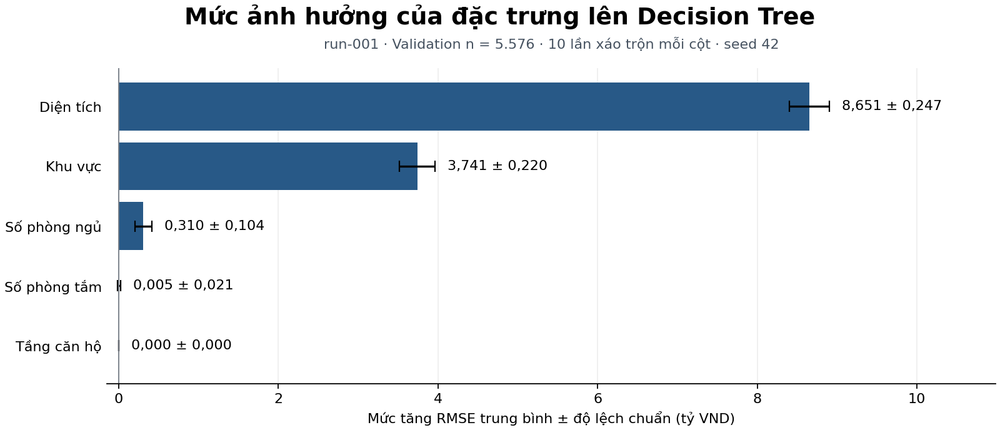
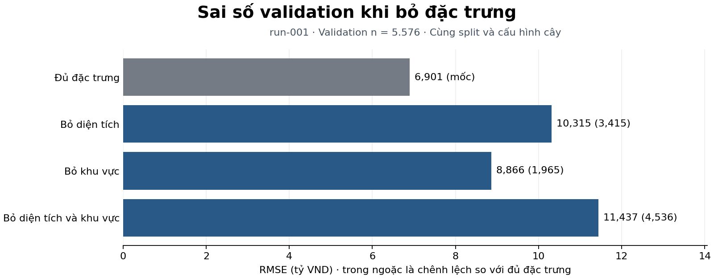
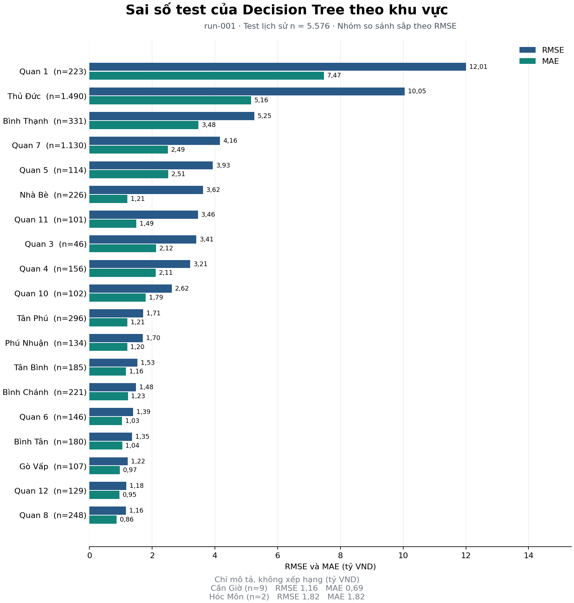
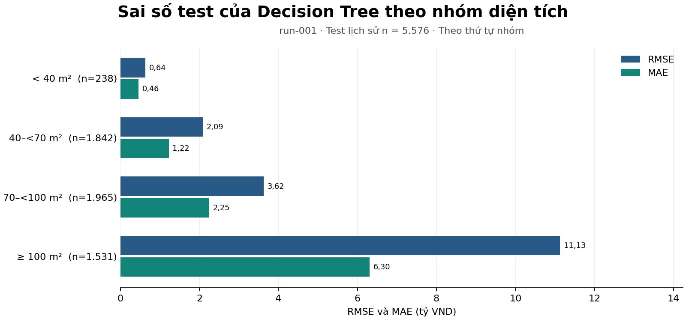
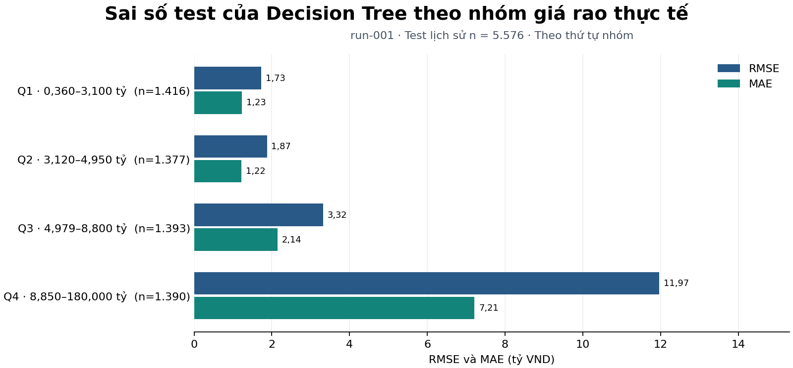

# Decision Tree và giải thích kết quả — run-001

## Dữ liệu và cách chọn cây

Run-001 đánh giá khả năng ước tính **tổng giá rao bán căn hộ** trên snapshot TiniX lịch sử (2025 đến tháng 03/2026, revision xác nhận `ca3fedc`). Sau xử lý còn 203.537 dòng và 37.172 nhóm. Pipeline chọn một đại diện mỗi nhóm, rồi dùng cùng split cho baseline và cả ba mô hình. Train có 26.020 nhóm, validation và test có 5.576 nhóm mỗi tập. Đây là kết quả cho giá rao lịch sử. Giá giao dịch và giá thị trường hiện hành nằm ngoài phạm vi đánh giá.

M3 dùng `DecisionTreeRegressor` với seed 42. Pipeline điền giá trị số thiếu và mã hóa one-hot khu vực, học tiền xử lý trên train. Cây chia các nhóm căn hộ theo các điều kiện trên đặc trưng đầu vào để giảm sai số bình phương và dự đoán giá trung bình của các mẫu train đi tới lá tương ứng.

Grid có 12 cấu hình, kết hợp độ sâu tối đa 3, 5, 8, 12 với số mẫu tối thiểu mỗi lá 5, 10, 20. Cấu hình thắng có **`max_depth=12` và `min_samples_leaf=10`**. Độ sâu 12 là giới hạn cấu hình. Mỗi lá cần ít nhất 10 mẫu train, giúp hạn chế các dự đoán dựa trên quá ít mẫu. Validation chọn cấu hình và chọn M3 trước khi khóa candidate. Test dùng để đánh giá sau khóa. [Cấu hình và validation](selection.json) · [Đánh giá test và bản ghi khóa](evaluation.json)

## So sánh ngoài mẫu

RMSE và MAE dưới đây dùng đơn vị tỷ VND. Mỗi cột test dùng cùng 5.576 nhóm. R² được báo riêng.

| Mô hình | RMSE validation | RMSE test | MAE test | R² test | Số dự đoán test ≤ 0 |
| --- | ---: | ---: | ---: | ---: | ---: |
| B0 Baseline | 13,150 | 12,348 | 5,364 | −0,087 | 0 |
| M1 Linear | 8,511 | 7,889 | 4,132 | 0,556 | 280 |
| M2 Polynomial | 8,431 | 7,871 | 4,071 | 0,558 | 242 |
| **M3 Decision Tree** | **6,901** | **6,332** | **2,947** | **0,714** | **0** |

RMSE test của cây thấp hơn Polynomial khoảng **19,6%** và thấp hơn baseline khoảng **48,7%**. Khoảng bootstrap 95% trên các nhóm test của cây là **5,824–6,938 tỷ VND** cho RMSE và **2,810–3,113 tỷ VND** cho MAE (1.000 lần lấy mẫu lại). Các khoảng này mô tả độ bất định của metric tổng hợp. Kết quả test không ghi nhận dự đoán không dương cho cây. Run hiện có metric validation và test, nên chưa định lượng được chênh lệch train–validation hay độ ổn định khi chuyển sang kỳ dữ liệu khác. RMSE cao ở các phân nhóm bên dưới vẫn là giới hạn quan trọng của cây. [Nguồn metric và bootstrap](evaluation.json)

## Permutation importance trên validation



Giữ nguyên cây đã chọn, lần lượt xáo trộn từng cột gốc trên validation (10 lần, seed 42) và đo mức tăng RMSE so với dữ liệu nguyên vẹn. Độ lệch chuẩn thể hiện mức dao động qua 10 lần xáo trộn.

| Đặc trưng | Mức tăng RMSE trung bình ± độ lệch chuẩn (tỷ VND) |
| --- | ---: |
| Diện tích | 8,651 ± 0,247 |
| Khu vực | 3,741 ± 0,220 |
| Số phòng ngủ | 0,310 ± 0,104 |
| Số phòng tắm | 0,005 ± 0,021 |
| Tầng căn hộ | 0,000 ± 0,000 |

Diện tích có ảnh hưởng lớn nhất đến dự đoán của cây, tiếp theo là khu vực. Số phòng ngủ đóng góp nhỏ hơn. Mức trung bình của số phòng tắm gần 0 và nhỏ hơn độ dao động giữa các lần xáo trộn. `floor_level` thiếu toàn bộ ở train, được giữ như cột hằng và không cung cấp tín hiệu trong run này.

**Importance không xác lập quan hệ nhân quả.** Các đặc trưng tương quan có thể chia sẻ thông tin, chẳng hạn diện tích và số phòng. Xáo trộn một cột cũng có thể tạo tổ hợp ít gặp trong thực tế. Kết quả đo mức độ cây dựa vào từng cột trong snapshot này. [Số liệu importance](importance.json)

## Ablation diện tích và khu vực



Mỗi ablation vô hiệu hóa cột tương ứng ở train và validation rồi fit lại với cấu hình 12/10 và cùng split. Giá trị tăng so với cây đầy đủ cho biết mức suy giảm khi pipeline có thể học lại từ các đặc trưng còn lại.

| Thí nghiệm | RMSE validation (tỷ VND) | Tăng so với đủ đặc trưng (tỷ VND) |
| --- | ---: | ---: |
| Đủ đặc trưng | 6,901 | Mốc |
| Bỏ diện tích | 10,315 | +3,415 |
| Bỏ khu vực | 8,866 | +1,965 |
| Bỏ cả diện tích và khu vực | 11,437 | +4,536 |

Cả hai phép phân tích đều cho thấy diện tích quan trọng hơn khu vực đối với cây. Mức tăng khi bỏ đồng thời hai cột được đo trực tiếp, vì các cột có thể chứa thông tin chồng lấp. [Số liệu ablation](importance.json)

## Sai số theo nhóm trên test đã khóa

### Khu vực



Trong các nhóm đủ điều kiện so sánh theo báo cáo, RMSE cao nhất ở **Quận 1 (12,01 tỷ, n=223)** và **Thủ Đức (10,05 tỷ, n=1.490)**. Cỡ mẫu chênh lệch đáng kể giữa các khu vực, nên đọc RMSE cùng MAE và n. Tên khu vực dùng nhãn theo quận cũ của snapshot. Báo cáo đánh dấu **Cần Giờ (n=9)** và **Hóc Môn (n=2)** là `descriptive_only` do n < 20. Hình ghi các số liệu của hai nhóm này ở phần mô tả riêng và không cấp hạng cho chúng.

### Diện tích



RMSE tăng từ **0,636 tỷ** ở nhóm dưới 40 m² lên **11,128 tỷ** ở nhóm từ 100 m² trở lên. MAE tương ứng là **0,460** và **6,302 tỷ VND**. Nhóm từ 100 m² có 1.531 mẫu. Cây có sai số tuyệt đối theo VND lớn hơn rõ rệt ở nhóm này.

### Giá rao thực tế



Q4 có khoảng giá quan sát **8,85–180 tỷ VND** và 1.390 mẫu. **RMSE 11,970 tỷ, MAE 7,212 tỷ**, cao nhất trong bốn nhóm giá. RMSE nhạy với sai số lớn, nên đọc cùng MAE. Các nhóm giá được lập từ giá rao thực tế trên test để chẩn đoán sai số. Giá rao thực tế không đi vào đặc trưng dự đoán.

Các bảng nhóm chứa sai số tổng hợp, nên chưa xác định được thiên lệch dự đoán cao hay thấp, nguyên nhân sai số, hoặc các căn cụ thể sai nhiều nhất. [Nguồn nhóm và cỡ mẫu](evaluation.json)

## Tái lập biểu đồ

Chạy từ thư mục gốc bằng Python có Matplotlib 3.10.8 để tái tạo cả năm PNG:

```powershell
python -m pip install matplotlib==3.10.8
python reports/run-001/plot_tree.py
```

Script đọc ba JSON tổng hợp và kiểm tra hash giữa importance và evaluation cùng cỡ mẫu test. Không tải dữ liệu gốc, đọc nhãn theo dòng hay chạy lại train.

| Định danh run-001 | SHA-256 |
| --- | --- |
| Dataset | `a57468f0449ad311bcc3bfaae4c227a361a9b38d7322ff161498c2bf31baec67` |
| Split | `551d291b34fda6f17c8f63692d8d15f2aa9d9e908dbecd6108942e8faa43dfde` |
| Candidate | `91d53acaa20662bdc5f674e4abc1992075b76c3c97259f60c8dedaac16e4f705` |
